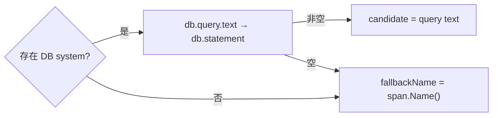
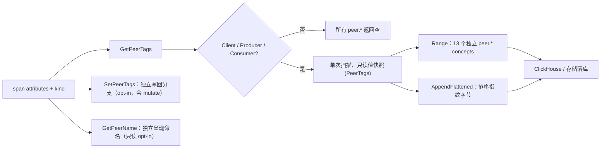
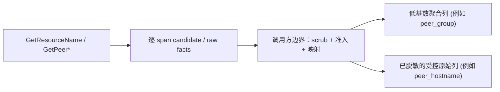

# otel-semconv-normalizer (`otlpmap`)

[](https://go.dev/)
[](https://opentelemetry.io/docs/specs/semconv/)
[](#生产落地与安全基线)
[](LICENSE)

高性能、零内存分配（0-Alloc）的 OpenTelemetry 语义属性扁平化归一库。

把 OpenTelemetry（OTLP）span / resource 属性映射成**扁平的、逐 span 落库的字段**（例如高性能存入 ClickHouse）：提供两个正交的分类列 `technology` + `entity_type`，外加 HTTP / URL / network / DB core 字段、出站 `peer.*`、operation name、resource name、service、env 和 version。

> [!IMPORTANT]
> 公开模块路径：`github.com/XiaoWeiKIN/otel-semconv-normalizer`。此仓库从独立公开快照开始，版本以本仓库发布的 tag 为准。

---

## 目录

- [核心特性](#核心特性)
- [快速开始](#快速开始)
  - [安装依赖](#安装依赖)
  - [基础使用示例](#基础使用示例)
  - [出站 Peer 的 4 种消费模式](#出站-peer-的-4-种消费模式)
- [核心设计：双正交分类维度](#核心设计双正交分类维度)
  - [两列设计原理](#两列设计原理)
  - [为什么 FaaS 是 `unknown + serverless`](#为什么-faas-是-unknown--serverless)
- [核心功能与提取列](#核心功能与提取列)
  - [1. HTTP / URL / Network 核心列](#1-http--url--network-核心列)
  - [2. Database 核心列](#2-database-核心列)
  - [3. 出站 `peer.*` 字段体系](#3-出站-peer-字段体系)
    - [端点字段的 OTel 官方迁移依据 (`server.address` & `server.port`)](#端点字段的-otel-官方迁移依据-serveraddress--serverport)
  - [4. 全量属性编织 (`semconvweave`)](#4-全量属性编织-semconvweave)
- [与 DataDog 的实质差异](#与-datadog-的实质差异)
- [生产落地与安全基线](#生产落地与安全基线)
  - [零堆分配（0-Alloc）热路径契约](#零堆分配0-alloc热路径契约)
  - [基数与 PII 安全边界](#基数与-pii-安全边界)
- [完整 API 速查](#完整-api-速查)
- [版本变更与迁移指南](#版本变更与迁移指南)
- [本地开发与测试](#本地开发与测试)
- [相关文档索引](#相关文档索引)
- [License](#license)

---

## 核心特性

- **极致性能与 0 堆分配**：输入直接基于 Collector `pcommon.Map` 与 `ptrace.SpanKind`，无包装对象、无中间 Map，热路径核心提取保持 0 allocation。
- **双正交分类模型**：独立拆分细粒度技术轴（`technology`）与有界角色轴（`entity_type`），彻底解决传统映射中技术被强行坍缩或角色污染的问题。
- **双代兼容与跨版本平滑演进**：以 **SemConv v1.41.0** 为 canonical 基准，所有查找均保证“新属性优先、旧属性兜底”，自动统一 1.30 等跨版本厂商命名变更（如 `mssql` 统一为 `microsoft.sql_server`）。
- **完整的出站对端识别 (`peer.*`)**：覆盖 13 个标准对端属性提取，支持高吞吐快照枚举、指纹生成及 ClickHouse ALIAS 读时显示名计算。
- **双层架构按需选用**：
  - **`otlpmap`**（根包）：高吞吐逐 span 派生列提取，专为扁平化宽表落库设计。
  - **`semconvweave`**（子包）：全量属性 Schema 编织归一，构建期编译生成静态决策表，运行时零反射、零动态 Schema 解析。

---

## 快速开始

### 安装依赖

```bash
go get github.com/XiaoWeiKIN/otel-semconv-normalizer@latest
```

### 基础使用示例

以下展示如何将接收到的 OTLP Span 和 Resource 属性直接转换为扁平化存储字段：

```go
package main

import (
	"fmt"

	otlpmap "github.com/XiaoWeiKIN/otel-semconv-normalizer"
	"go.opentelemetry.io/collector/pdata/pcommon"
	"go.opentelemetry.io/collector/pdata/ptrace"
)

func main() {
	// 模拟 OTLP Span Attributes
	spanAttrs := pcommon.NewMap()
	spanAttrs.PutStr("db.system.name", "redis")
	spanAttrs.PutStr("db.query.text", "GET user:1001")
	spanAttrs.PutStr("server.address", "redis-cluster-node-1")
	spanKind := ptrace.SpanKindClient
	spanName := "GET"

	// 模拟 Resource Attributes
	resourceAttrs := pcommon.NewMap()
	resourceAttrs.PutStr("service.name", "order-service")
	resourceAttrs.PutStr("deployment.environment.name", "production")
	resourceAttrs.PutStr("service.version", "1.4.0")

	// 提取正交分类列
	technology := otlpmap.GetTechnology(spanAttrs)               // "redis"
	entityType := otlpmap.GetEntityType(spanAttrs, spanKind)     // "cache"

	// 提取核心 Operation / Resource
	operation := otlpmap.GetOperationName(spanAttrs, spanKind)   // "redis.query"
	resource := otlpmap.GetResourceName(spanAttrs, spanKind, spanName) // "GET user:1001"

	// 提取 Resource 服务环境元数据
	service := otlpmap.GetServiceName(resourceAttrs)                    // "order-service"
	env := otlpmap.GetDeploymentEnvironmentName(resourceAttrs)          // "production"
	version := otlpmap.GetServiceVersion(resourceAttrs)                 // "1.4.0"

	fmt.Printf("Tech: %s | Entity: %s | Op: %s | Res: %s\n", technology, entityType, operation, resource)
	fmt.Printf("Service: %s | Env: %s | Version: %s\n", service, env, version)
}
```

### 出站 Peer 的 4 种消费模式

针对出站 Span（`Client`、`Producer`、`Consumer`），库提供了 4 种互斥的消费模式，请根据场景选择一种，**切勿在同一条 span 热路径上重叠调用**：

```go
// 模式 1：独立 Getter（只读取少量指定列，简单直观）
func readPeerColumnsIndividually(span ptrace.Span) {
	attrs, kind := span.Attributes(), span.Kind()
	service := otlpmap.GetPeerService(attrs, kind)    // "checkout-service"
	hostname := otlpmap.GetPeerHostname(attrs, kind)  // "api.internal"
	_ = service
	_ = hostname
}

// 模式 2：快照 + 外部 Buffer（推荐：高吞吐下同时需要多列与指纹，0 Allocation）
func readPeerSnapshot(span ptrace.Span, flattenedBuffer []byte) []byte {
	peerTags := otlpmap.GetPeerTags(span.Attributes(), span.Kind())
	peerTags.Range(func(concept otlpmap.Concept, value string) bool {
		// 遍历写入 ClickHouse 独立 peer.* 列
		return true
	})
	// 复用外部 buffer 序列化已排序指纹，跨 span 零内存分配
	flattenedBuffer = peerTags.AppendFlattened(flattenedBuffer[:0])
	return flattenedBuffer
}

// 模式 3：兼容批量迭代 API（仅需批量枚举已有 13 个 concept，0 Allocation）
func readPeerWithCompatibilityAPI(span ptrace.Span) {
	otlpmap.RangePeerAttributes(span.Attributes(), span.Kind(), func(concept otlpmap.Concept, value string) bool {
		// 消费非空 concept
		return true
	})
}

// 模式 4：显式写回模式（opt-in：确实需要原地增强/改写 pdata attributes，会分配并 mutate）
func enrichPeerAttributes(span ptrace.Span) {
	// 在 span.Attributes() 原地写入 13 个 peer.* 以及 otelmap.flattened.peer.tags 指纹
	otlpmap.SetPeerTags(span.Attributes(), span.Kind())
}
```

---

## 核心设计：双正交分类维度

### 两列设计原理

一个 Span 具备两个**相互独立**的属性轴。将其硬压进单一维度必然造成信息丢失，因此本库拆分为两列：

| 列名 | 关注轴心 | 对应函数 | 取值范围 | 核心用途 |
| :--- | :--- | :--- | :--- | :--- |
| **`technology`** | **哪种技术**（细粒度、无损） | `GetTechnology` | `mysql` / `clickhouse` / `redis` / `kafka` / `grpc` / `http` / `unknown` | 精确下钻过滤（如“定位所有 clickhouse 慢查询”） |
| **`entity_type`** | **哪种角色**（粗粒度、有界） | `GetEntityType` | `web` / `http` / `db` / `cache` / `rpc` / `queue` / `serverless` / `custom` | `GROUP BY` 聚合、拓扑图节点图标、快速过滤 |

#### 典型场景映射对照

| Span 实际场景 | `technology` | `entity_type` | 设计要点 |
| :--- | :--- | :--- | :--- |
| ClickHouse 查询 | `clickhouse` | `db` | 区分特定数据库，角色归为 `db` |
| Redis 命令调用 | `redis` | `cache` | 精确技术为 `redis`，角色归为 `cache` |
| Kafka 消息生产/消费 | `kafka` | `queue` | 保留 `kafka`，不坍缩为 `queue` |
| gRPC RPC 远程调用 | `grpc` | `rpc` | 细粒度 RPC 引擎识别 |
| HTTP 服务端入站 | `http` | `web` | 角色为服务端 Web 入口 |
| HTTP 客户端出站 | `http` | `http` | 角色为外部依赖调用 |
| Lambda / FaaS 函数调用 | `unknown`（具体平台未知） | `serverless` | 角色确立为 serverless，平台由 Resource 描述 |
| 纯内部调用（Internal Span） | `unknown` | `custom` | 无外部系统，兜底为 custom 实体 |

> [!TIP]
> **无损技术保证**：`GetTechnology` **绝不坍缩**。与 Datadog 把所有 SQL 引擎强行折叠为 `sql`、把所有消息引擎归为 `queue` 不同，本库精确区分 `mysql` vs `clickhouse`、`kafka` vs `rabbitmq`、`grpc` vs `dubbo`。同时，`GetTechnology` **绝不输出 `web` / `custom` 等角色值**，两轴各司其职，互不污染。

---

**默认值迁移**：技术不可识别时，`GetTechnology` 现在返回 `unknown`（`TechnologyUnknown`），不再返回空字符串。已知技术和未知的非空厂商值保持原有处理；本函数不写回原始属性。调用方应将空值判断改为与 `TechnologyUnknown` 比较；历史存储中的空值可在查询时统一为 `unknown`，直到历史数据过期或完成回填后移除兼容。该默认值约定更新了下述历史 ADR-9 中的空值表示，不改变“不猜测 FaaS 平台”的决策。

### 为什么 FaaS 是 `unknown + serverless`

这是显式架构契约，并非缺失实现：

1. **角色可确认**：`GetEntityType` 根据 `faas.trigger` 或 `faas.invoked_name` 可 100% 判定为 `serverless` 角色。
2. **平台不可盲猜**：
   - `faas.invoked_provider` 仅代表云厂商（`aws` / `azure` / `gcp`），并非平台技术；
   - `faas.invoked_name` 是具体的函数资源名，放入 `technology` 会导致基数爆炸且破坏技术语义；
   - `faas.trigger` 表达的是触发途径（`http` / `pubsub` / `timer`），而非执行环境。

OTel 规范中，本地执行环境由 Resource 属性 `cloud.platform`（如 `aws_lambda`）表达。当前 API 输入为 Span Attributes，对于出站 FaaS 调用，调用端的 Resource 仅代表调用方自己，不能偷换为远端被调用方的技术。因此本库坚持不凭空臆造。

#### 混合属性识别优先级

当 Span 同时包含多种属性时，优先级判定如下：

| 可识别信号特征 | `technology` | `entity_type` | 判定机制 |
| :--- | :--- | :--- | :--- |
| **仅含 FaaS 角色标记** | `unknown` | `serverless` | 标准 FaaS 契约 |
| **FaaS + DB** | DB 技术 (如 `mysql`) | `db` / `cache` | DB 信号优先判定 |
| **FaaS + Messaging** | Messaging 技术 (如 `kafka`) | `queue` | 消息信号优先判定 |
| **FaaS + RPC** | RPC 技术 (如 `grpc`) | `rpc` | RPC 信号优先判定 |
| **FaaS + HTTP** | `http` | `serverless` | 识别为基于 HTTP 的 serverless 触发 |
| **仅含 invoked provider** | `unknown` | 按 SpanKind fallback | provider 单独不足以认定为 FaaS |

- **`GetTechnology` 优先级**：`DB → messaging → RPC → HTTP → unknown`
- **`GetEntityType` 优先级**：`DB/cache → messaging → RPC → FaaS → HTTP → SpanKind Fallback`

---

## 核心功能与提取列

### 1. HTTP / URL / Network 核心列

这些 API 直接将跨版本属性映射为 current SemConv 标准列，不产生中间 Map，不改写原始 `pcommon.Map`：

| 规范 Canonical 列 | 提取函数 | 属性查找优先级 (Current → Legacy) | 行为与特性 |
| :--- | :--- | :--- | :--- |
| `http.request.method` | `GetHTTPRequestMethod` | `http.request.method → http.method` | 10 个标准方法原样输出；未知方法输出 `_OTHER` |
| `http.request.method_original` | `GetHTTPRequestMethodOriginal` | Current companion 列 | 当 method 为未知方法时保留原始字面量（如 `PROPFIND`） |
| `http.response.status_code` | `GetHTTPResponseStatusCode` | `http.response.status_code → http.status_code` | 返回 `(int64, bool)`；仅识别合法整型，类型错误平滑 fallback |
| `url.full` | `GetURLFull` | `url.full → http.url` | 完整原始 URL；高基数，落库前由调用方完成脱敏 |
| `url.scheme` | `GetURLScheme` | `url.scheme → http.scheme` | 如 `http` / `https` |
| `url.template` | `GetURLTemplate` | Current only | 客户端路由模板（如 `/users/{id}`），低基数聚合首选 |
| `http.route` | `GetHTTPRoute` | Current only | 服务端路由模板（如 `/orders/:id`），低基数聚合首选 |
| `user_agent.original` | `GetUserAgentOriginal` | `user_agent.original → http.user_agent` | 原始 UA 字符串 |
| `network.protocol.name` | `GetNetworkProtocolName` | `network.protocol.name → net.protocol.name` | 网络协议名（如 `http`） |
| `network.transport` | `GetNetworkTransport` | `network.transport → net.transport` | 自动将 legacy 值 `ip_tcp → tcp`、`ip_udp → udp` 归一 |

---

### 2. Database 核心列

针对 SemConv 1.30 的重大重组，本库采用静态 current → legacy 优先级，将碎片化的厂商专有字段安全统一：

| 规范 Canonical 列 | 提取函数 | 查找优先级与厂商旧属性合并规则 |
| :--- | :--- | :--- |
| `db.operation.name` | `GetDBOperationName` | `db.operation.name → db.operation` |
| `db.collection.name` | `GetDBCollectionName` | Current → `db.sql.table → db.cassandra.table → db.mongodb.collection → db.cosmosdb.container` |
| `db.namespace` | `GetDBNamespace` | Current → `db.name → db.redis.database_index → db.mssql.instance_name` |
| `db.query.summary` | `GetDBQuerySummary` | Current only（如 `SELECT orders`） |
| `db.query.text` | `GetDBQueryText` | `db.query.text → db.statement` |

#### Database Operation 与 Resource 命名规则

- **`GetOperationName`**：在 DB client span 上优先格式化为 `<system>.<operation>`（如 `mysql.select`）；若缺少 operation，则保持 `<system>.query`。
- **`GetResourceName`**：按以下逻辑选定 candidate（截断阈值 5000 bytes）：



> [!CAUTION]
> **SQL Sanitization 前提保证**
> 本库在 Collector 热路径中**不重复解析或清洗 SQL**。发行版契约要求接入的 OTel Agent 在导出前已开启 SQL 脱敏（字面量转为 `?`）。若接入来源未经清洗，**调用方必须在调用本库前完成脱敏，严禁直接落库**。

---

### 3. 出站 `peer.*` 字段体系

`GetPeer*` 专用于提取下游调用对端信息，**仅对 `Client`、`Producer`、`Consumer` 生效**；`Server`、`Internal`、`Unspecified` 一律安全返回空。



#### 13 个 Peer 规范 Concepts

| 输出 Concept / 列 | 提取函数 | 来源属性顺序与规则 |
| :--- | :--- | :--- |
| `peer.service` | `GetPeerService` | `peer.service`（v1.39 已废弃，兼容期内持续读取） |
| `peer.hostname` | `GetPeerHostname` | `server.address → net.peer.name`（原值输出，不拼端口） |
| `peer.db.name` | `GetPeerDBName` | `db.namespace → db.name` |
| `peer.messaging.destination` | `GetPeerMessagingDestination` | `messaging.destination.name → messaging.destination` |
| `peer.rpc.service` | `GetPeerRPCService` | `rpc.service`（v1.39 已废弃，兼容期内持续读取） |
| `peer.aws.dynamodb.table` | `GetPeerAWSDynamoDBTable` | `aws.dynamodb.table_names`（列表取首个非空表名） |
| `peer.aws.s3.bucket` | `GetPeerAWSS3Bucket` | `aws.s3.bucket` |
| `peer.aws.kinesis.stream` | `GetPeerAWSKinesisStream` | `aws.kinesis.stream_name`（v1.34 起新增） |
| `peer.kafka.bootstrap.servers` | `GetPeerKafkaBootstrapServers` | `messaging.kafka.bootstrap.servers`（OTel Java Experimental 提取） |
| `peer.rocketmq.broker` | `GetPeerRocketMQBroker` | `messaging.rocketmq.broker_address`（OTel Java Experimental 提取） |
| `peer.db.system` | `GetPeerDBSystem` | `db.system.name → db.system → db.type`（值经拼写规范化） |
| `peer.messaging.system` | `GetPeerMessagingSystem` | `messaging.system`（值经拼写规范化） |
| `peer.rpc.system` | `GetPeerRPCSystem` | `rpc.system.name → rpc.system`（值经拼写规范化） |

#### 端点字段的 OTel 官方迁移依据 (`server.address` & `server.port`)

在网络与端点属性演进中，OTel 官方对旧字段有明确的替代与废弃规定：
- 官方 [Network 属性注册表](https://opentelemetry.io/docs/specs/semconv/registry/attributes/network/#deprecated-network-attributes) 将 `net.peer.name` 与 `net.peer.port` 标记为 Deprecated，并按 Span 方向明确规定了替代映射：

| 旧字段 (Deprecated) | Client Span 替代字段 | Server Span 替代字段 |
| :--- | :--- | :--- |
| `net.peer.name` | `server.address` | `client.address` |
| `net.peer.port` | `server.port` | `client.port` |

- **特定领域规范支持**：
  - **HTTP 调用**：[HTTP 客户端属性官方迁移说明](https://opentelemetry.io/docs/specs/semconv/non-normative/http-migration/#http-client-span-attributes) 单独列出了上述映射规则；
  - **数据库调用**：MySQL 等数据库 Client Span 同样适用上述通用规则，且在 [数据库 Client Span 规范](https://opentelemetry.io/docs/specs/semconv/db/database-spans/) 中，`server.address` 被标准定义为数据库主机名。

> [!NOTE]
> **归一化职责与迁移期策略**
> 需要准确区分：OTel 官方规范定义的是**字段语义迁移替代关系**，但并没有强制要求必须由 Collector 或某个归一化库在运行时完成转换；且旧版 instrumentation 在过渡期继续上报旧字段是官方标准允许的行为（参见 [HTTP 迁移策略指南](https://opentelemetry.io/docs/specs/semconv/non-normative/http-migration/)）。
> 因此，在下游存储与查询侧（如 ClickHouse）统一按 `server.address` / `server.port` 建立 Facet 索引的前提下，**在消费落库前由本库完成这两项属性的归一化映射**，具有明确、权威的 OTel 语义依据。

#### 明确排除的陈旧 / 私有属性

为杜绝非标准或高污染属性侵入，以下来源已明确不在消费路径中：
- **Host 类别**：`hostname`、`db.hostname`、`network.destination.name`、`grpc.host`、`http.host`、`http.server_name`
- **DB / Messaging**：`db.instance`、`mongodb.db`、`cassandra.keyspace`、`db.cassandra.contact.points`、`db.couchbase.seed.nodes`
- **私有资源名**：`tablename`、`bucketname`、`streamname`、`queuename`、`topicname`、`aws.queue.name`、`_dd.base_service`

#### `GetPeerName`：读时命名呈现策略

`GetPeerName` 按领域挑出单个最适合展示的名称（如 DB 域 `db.name > dynamodb.table > hostname > db.system`）。
**最佳实践建议在 ClickHouse 查询侧通过 `ALIAS` 或视图读时计算**，零额外存储且业务策略灵活可改：

```sql
-- ClickHouse 读时计算等价 peer_name（对齐 GetPeerName 规范）
peer_name String ALIAS multiIf(
  peer_service != '', peer_service,
  peer_db_system != '', coalesce_nonempty(peer_db_name, peer_aws_dynamodb_table, peer_hostname, peer_db_system),
  peer_messaging_system != '', coalesce_nonempty(peer_messaging_destination, peer_kafka_bootstrap_servers, peer_rocketmq_broker, peer_aws_kinesis_stream, peer_messaging_system),
  coalesce_nonempty(peer_rpc_service, peer_aws_s3_bucket, peer_hostname)
)
```

---

### 4. 全量属性编织 (`semconvweave`)

如果除了核心标量列之外，还需要对 Span 的全部 Key-Value 属性做完整的 Schema 迁移与映射（例如升级到 v1.41.0），可以使用子包 `semconvweave`：

- **零运行时解析**：所有 SchemaURL、Weaver 规则、Migration Guides 均在构建期被编译为静态 Go 表，运行期纯查表。
- **不改写原 Map**：直接输出 `AttributeDecision`（`AttributeSuppress` / `AttributeReplaceString` / `AttributeKeepValue`），直通序列化管道。

```go
import "github.com/XiaoWeiKIN/otel-semconv-normalizer/semconvweave"

// 根据 Schema URL 解析一次编织 ID
weave := semconvweave.Resolve("https://opentelemetry.io/schemas/1.7.0")

// 在属性序列化循环中消费决策
decision := weave.SpanAttribute(sourceAttrs, "SELECT * FROM users", "db.system", val)
// 决策将自动把 legacy "mssql" 转换为 "db.system.name" -> "microsoft.sql_server"
```

完整接入机制请查阅 [semconvweave Quickstart](./semconvweave/README.md)。

---

## 与 DataDog 的实质差异

本项目在架构上借鉴了 [`DataDog/datadog-agent` 的 `pkg/opentelemetry-mapping-go`](https://github.com/DataDog/datadog-agent/tree/main/pkg/opentelemetry-mapping-go) 的“提取函数 + 静态映射表”思想，但在实际生产场景中解决了两个严重痛点：

### 1. 语义版本全面兼容（修复漏判 Bug）
- **Datadog 现状**：映射逻辑基本只读旧属性名（`db.system`、`rpc.system`、`http.method`），缺少现行 stable 属性（`db.system.name`、`rpc.system.name`、`url.full` 等）。
  **后果**：若被监控应用启用了现行 OTel 规范（`OTEL_SEMCONV_STABILITY_OPT_IN`），其数据库调用会被 DD 错误降级判定为 `http`。
- **本库实现**：每一处查找严格遵循**“新规范在前，旧属性兜底”**（`GetOTelAttrVal`），两代规范均能精准识别，对处于升级迁移期的服务无缝兼容。

### 2. 跨版本值拼写统一（解决 Group By 分裂）
- **Datadog 现状**：仅匹配 Key，忽略了 Value 的演进。在 SemConv 1.30 中，15+ 种技术增加了云厂商前缀（例如 `mssql → microsoft.sql_server`、`dynamodb → aws.dynamodb`）。
  **后果**：不同版本的 SDK 采集同一数据库，落入数据库的取值完全不同，导致 APM 图表和 `GROUP BY` 查询被分裂为两行。
- **本库实现**：内置 `canonicalizeTechnology` 编译期静态分派表，将拼写变体严格统一到 v1.41.0 规范（**只统拼写，绝不合并技术**，`mysql != clickhouse` 毫厘不差）。

---

## 生产落地与安全基线

### 零堆分配（0-Alloc）热路径契约

在高并发指标与链路数据管道中，任何内存分配都会急剧增加 GC 压力。

- **标量 Getter 契约**：所有 `Get*` 核心函数在标准 current/legacy 查找路径上保证 **0 allocation**。
- **快照复用契约**：`GetPeerTags` 产出只读快照；通过调用方传入预分配的 `dst` 切片，`peerTags.AppendFlattened(dst)` 保证 **0 allocation**。
- **自动化门禁**：仓内集成严苛的 Benchmark 与 hard allocation 单元测试，杜绝任何性能劣化代码合入。

### 基数与 PII 安全边界



1. **候选值（Candidate）防卫**：`GetResourceName`、`url.full`、`user_agent.original` 和 `peer.hostname` 均为原始事实候选值。若客户端代码未规范埋点，极易包含动态 ID、Token 或 PII 敏感信息。
2. **脱敏优先原则**：无法确认安全的 URL 参数、SQL 文本或 Hostname 必须由 Agent 前置脱敏或在入库流水线中直接清洗 / 丢弃（Fail Closed）。
3. **聚合治理**：针对 `peer.hostname`、Broker 列表等高基数列，推荐采用有界映射派生出受控的 `peer_group` 维度用于大盘聚合，原始列仅作故障定位下钻，防止 ClickHouse 索引膨胀。

详细规范参见 [Resource / Peer 基数与 PII 落库策略](./docs/resource-cardinality-policy.md)。

---

## 完整 API 速查

| 分类 | 函数 / 类型标识 | 输入参数 | 返回值 / 说明 |
| :--- | :--- | :--- | :--- |
| **语义概念** | `Concept*` | 常量 | `ConceptOperationName`、`ConceptResourceName`、`ConceptPeer*` 等规范标识 |
| **双正交分类** | `GetTechnology` | `attrs pcommon.Map` | `string`：无损技术列（如 `clickhouse`、`redis`、`unknown`） |
| | `GetEntityType` | `attrs, kind` | `EntityType`：有界角色列（`web` / `db` / `cache` / `queue` / `rpc` 等） |
| **基础信息** | `GetOperationName` | `attrs, kind` | `string`：标准化操作名（如 `mysql.select`） |
| | `GetResourceName` | `attrs, kind, fallback` | `string`：资源名 candidate，第三参传入 `span.Name()` |
| **HTTP / 网络** | `GetHTTPRequestMethod` | `attrs` | `string`：规范方法名，未知时返回 `_OTHER` |
| | `GetHTTPRequestMethodOriginal` | `attrs` | `string`：未知方法保留的原始值 |
| | `GetHTTPResponseStatusCode` | `attrs` | `(int64, bool)`：HTTP 状态码及是否存在 |
| | `GetURLFull` / `GetURLScheme` | `attrs` | `string`：完整 URL 与 Scheme |
| | `GetURLTemplate` / `GetHTTPRoute` | `attrs` | `string`：Client / Server 路由模板 |
| | `GetUserAgentOriginal` | `attrs` | `string`：原始 User-Agent |
| | `GetNetworkProtocolName` | `attrs` | `string`：协议名（如 `http`） |
| | `GetNetworkTransport` | `attrs` | `string`：传输层协议（已做 `tcp`/`udp` 规范化） |
| **数据库** | `GetDBOperationName` | `attrs` | `string`：操作类型（如 `select`） |
| | `GetDBCollectionName` | `attrs` | `string`：表 / 集合名（已合并各数据库专有属性） |
| | `GetDBNamespace` | `attrs` | `string`：数据库名 / Namespace |
| | `GetDBQuerySummary` | `attrs` | `string`：SQL 概要摘要 |
| | `GetDBQueryText` | `attrs` | `string`：已清洗的 SQL 原文 |
| **出站 Peer** | `GetPeerService` | `attrs, kind` | `string`：对端服务名 |
| | `GetPeerHostname` | `attrs, kind` | `string`：对端主机 / 地址 |
| | `GetPeerDBName` / `GetPeerDBSystem` | `attrs, kind` | `string`：对端 DB 库名与系统类型 |
| | `GetPeerMessagingDestination` | `attrs, kind` | `string`：消息队列 Topic / Queue 名 |
| | `GetPeerMessagingSystem` | `attrs, kind` | `string`：消息中间件系统类型 |
| | `GetPeerRPCService` / `GetPeerRPCSystem` | `attrs, kind` | `string`：RPC 目标服务与系统类型 |
| | `GetPeerAWSDynamoDBTable` | `attrs, kind` | `string`：DynamoDB 首个有效表名 |
| | `GetPeerAWSS3Bucket` / `Stream` | `attrs, kind` | `string`：S3 Bucket / Kinesis Stream |
| | `GetPeerKafkaBootstrapServers` | `attrs, kind` | `string`：Kafka Broker 列表（实验性） |
| | `GetPeerRocketMQBroker` | `attrs, kind` | `string`：RocketMQ Broker 地址（实验性） |
| | `GetPeerTags` | `attrs, kind` | `PeerTags`：只读值快照（支持 `Range` 与 `AppendFlattened`） |
| | `RangePeerAttributes` | `attrs, kind, yield` | 批量遍历非空 peer concepts（0 alloc） |
| | `GetFlattenedPeerTags` | `attrs, kind` | `string`：排序后的 `name:value` 指纹字符串 |
| | `SetPeerTags` | `attrs, kind` | **原地改写**：写回 13 个 `peer.*` 属性与指纹键 |
| | `GetPeerName` | `attrs, kind` | `string`：按优先级挑选的单个呈现名（建议查询侧算） |
| **服务与环境** | `GetServiceName` | `resAttrs pcommon.Map` | `string`：服务名（缺省 `unknown_service`） |
| | `GetDeploymentEnvironmentName` | `resAttrs` | `string`：部署环境（缺省 `default`） |
| | `GetServiceVersion` | `resAttrs` | `string`：服务版本号（缺省 `""`） |
| **通用工具** | `GetOTelAttrVal` | `attrs, keys...` | `string`：按优先级返回首个非空属性（自动类型转字符串） |

---

## 版本变更与迁移指南

### 1. Go Module 路径

使用 `github.com/XiaoWeiKIN/otel-semconv-normalizer`。首次公开快照不继承此前版本标签。

公开版本的 `SetPeerTags` 将排序后的对端标签写入 `otelmap.flattened.peer.tags`。该键属于本项目扩展；它只写入这个公开键，不迁移或删除调用方已有的其他扩展属性。标准 `peer.*` 键与 Go 函数签名保持不变。

### 2. API 命名收口与破坏性变更
为了使语义与 Datadog 及 OpenTelemetry 规范保持严密一致，以下历史 API 已在当前版本中收口：
- `GetPeerAddress` **已更名为** `GetPeerHostname`（输出概念对应对齐为 `peer.hostname`）。
- `GetDeploymentEnvironment` **已更名为** `GetDeploymentEnvironmentName`（默认常量同步更名为 `DefaultDeploymentEnvironmentName`）。
- 项目不保留废弃别名，升级时请统一替换调用点。

---

## 本地开发与测试

历史性能实验的脚本、全部样本、报告和 CPU profiles 见 [benchmarks/](benchmarks/README.md)。这些是明确标注的脱敏副本，包含原始 `inconclusive` 结果；公开文件可用独立清单校验。

本项目为纯 Go 单体库，无外部服务依赖，拉取仓库后即可执行完整测试套件：

```bash
# 运行全部单元测试、契约测试与竞态检测
go test -race ./...

# 静态代码检查
go vet ./...

# 格式化验证
gofmt -l .
```

---

## 相关文档索引

深入了解设计原理与生产运维策略：

- [系统架构与边界 (docs/architecture.md)](docs/architecture.md)
- [文档全景地图 (docs/index.md)](docs/index.md)
- [SemConv 兼容性支持策略 (docs/semconv-compatibility-policy.md)](docs/semconv-compatibility-policy.md)
- [SemConv 运维与版本观测手册 (docs/semconv-observability-runbook.md)](docs/semconv-observability-runbook.md)
- [Resource 与 Peer 基数控制及 PII 策略 (docs/resource-cardinality-policy.md)](docs/resource-cardinality-policy.md)
- [semconvweave 快速上手指南 (semconvweave/README.md)](semconvweave/README.md)

### OTel 官方规范与迁移策略参考

- [OTel Network 属性注册表 (Deprecated Network Attributes)](https://opentelemetry.io/docs/specs/semconv/registry/attributes/network/#deprecated-network-attributes)
- [OTel HTTP 客户端属性官方迁移说明](https://opentelemetry.io/docs/specs/semconv/non-normative/http-migration/#http-client-span-attributes)
- [OTel 数据库 Client Span 规范](https://opentelemetry.io/docs/specs/semconv/db/database-spans/)
- [OTel HTTP 迁移策略指南](https://opentelemetry.io/docs/specs/semconv/non-normative/http-migration/)

---

## License

本项目基于 [Apache-2.0](LICENSE) 协议开源。
项目架构参考了 DataDog/datadog-agent（同为 Apache-2.0）的 `opentelemetry-mapping-go` 设计，但为独立实现，未复制其代码或专有属性映射表。
