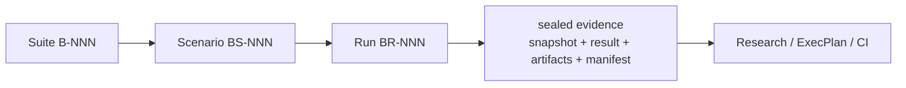

# Engineering Benchmarks

> Public redacted distribution of historical evidence. Read [the publication and integrity notes](README.md) before using the original seal identifiers. Use `python3 benchmarks/verify_publication.py` to check public bytes.

This file is the repository entry point and rebuildable index for reproducible
Benchmark evidence.

## How to read this index

- A Suite (`B-NNN`) defines a long-lived measurement subject, accountable
  owner, safety boundary, and expected consumers.
- A Scenario (`BS-NNN`) predeclares one reusable protocol and decision rule
  before results are visible.
- A Run (`BR-NNN`) records one execution against immutable subject and harness
  revisions. Its sealed bundle contains the Scenario snapshot, Result,
  artifacts, and Evidence Manifest.
- Existing load-test scripts remain in the normal source tree. A Scenario names
  their executable entrypoint; the Run records the exact harness revision.
- Research may interpret several sealed Runs. An ExecPlan declares Scenario IDs
  as independent completion gates. CI and Runbooks may repeat stable Scenarios.
- The managed tables below are projections. The historical tables are preserved here; do not reindex or reseal copied Runs.

## Suites

| ID | Status | Title | Owner | Scenarios | Runs | Path |
|---|---|---|---|---:|---:|---|
| [B-001](suites/b-001_span-projection/BENCHMARK.md) | active | Span attribute projection performance | otel-span-classifier maintainers | 2 | 3 | `suites/b-001_span-projection/BENCHMARK.md` |

## Scenarios

| ID | Suite | Status | Title | Runs | Path |
|---|---|---|---|---:|---|
| [BS-001](suites/b-001_span-projection/scenarios/bs-001_bitmap-dispatch.md) | B-001 | active | Bitmap dispatch and bulk copy against frozen projection | 1 | `suites/b-001_span-projection/scenarios/bs-001_bitmap-dispatch.md` |
| [BS-002](suites/b-001_span-projection/scenarios/bs-002_selective-migration.md) | B-001 | active | Selective migration work and sparse map projection | 2 | `suites/b-001_span-projection/scenarios/bs-002_selective-migration.md` |

## Runs

| ID | Scenario | Status | Outcome | Subject revision | Supersedes | Path |
|---|---|---|---|---|---|---|
| [BR-001](suites/b-001_span-projection/runs/br-001_bitmap-bulk-copy/RESULT.md) | BS-001 | sealed | passed | sha256:b0d42643e6ae21d4f656fdeace0898f052f46ea4103ffdc767ff6e1e943aa38c | — | `suites/b-001_span-projection/runs/br-001_bitmap-bulk-copy/RESULT.md` |
| [BR-002](suites/b-001_span-projection/runs/br-002_selective-sparse/RESULT.md) | BS-002 | sealed | inconclusive | sha256:d1254df33748ef2d72c1cee5362c135ed986d91c64c495f76638b594bf1973cc | — | `suites/b-001_span-projection/runs/br-002_selective-sparse/RESULT.md` |
| [BR-003](suites/b-001_span-projection/runs/br-003_selective-sparse-repeat/RESULT.md) | BS-002 | sealed | passed | sha256:d1254df33748ef2d72c1cee5362c135ed986d91c64c495f76638b594bf1973cc | BR-002 | `suites/b-001_span-projection/runs/br-003_selective-sparse-repeat/RESULT.md` |
