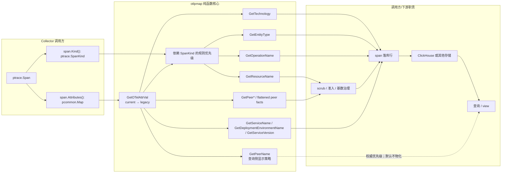
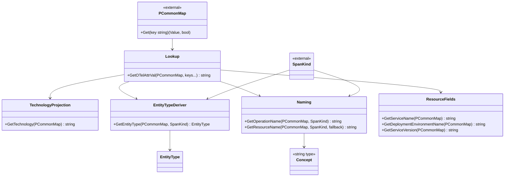
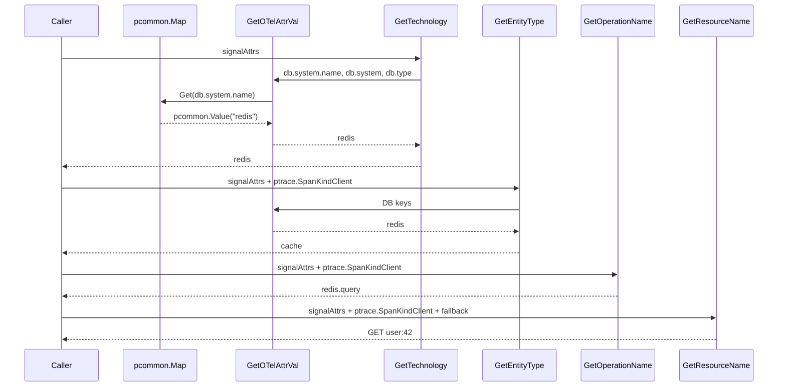
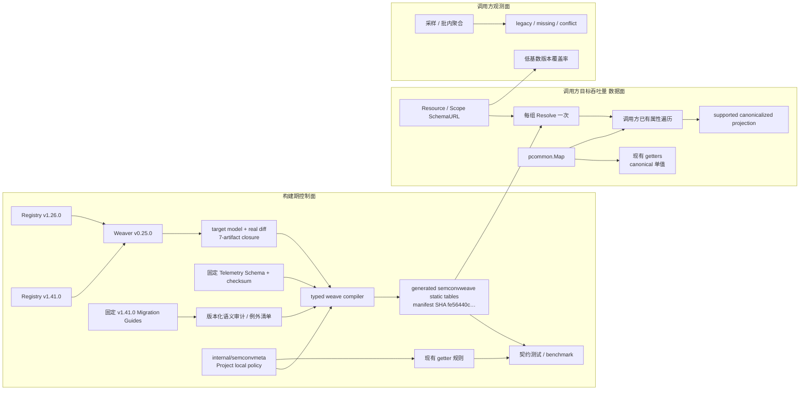

# otel-semconv-normalizer 架构

**日期：** 2026-07-29 
**项目类型：** Go library 
**架构模式：** Collector pdata 直接输入 + 无状态函数式规则核心

## 1. 执行摘要

`otel-semconv-normalizer` 当前实现为 package `otlpmap`，负责把单个 OTLP span/resource 的语义属性投影成适合逐 span 落库的扁平字段。它不是 collector、服务或 trace 聚合器：不解析 OTLP wire 协议，不持有 trace 状态，不做 I/O，也不负责 ClickHouse 写入。

核心架构决策是直接采用 Collector 的 `pcommon.Map` 与 `ptrace.SpanKind`，并把所有业务行为实现为同步纯函数。Collector 调用方可以原样传入 `span.Attributes()` 与 `span.Kind()`，不再构造 adapter 或中间属性 map。本库只负责 OTLP 值字符串化、版本化 key 查找、规则优先级和输出命名。输入属性 key 保持字符串，归一输出标识则使用独立的 `Concept` 类型。

现有 getter 之外，仓库已实现独立 `semconvweave` 子包：构建期把受支持的 OTel Schema 折叠为静态
weave，并以 Weaver target model/真实 diff 和固定 v1.41.0 Migration Guides 审计 Schema 无法
完整表达的语义变化；调用方可在已有遍历中生成受支持变换的 canonicalized projection。实现等待
统一 code review，详见[Schema 归一化设计](weaver-build-contract.md)。

## 2. 系统边界

边界约束：

- `GetOTelAttrVal` 通过 `pcommon.Value.AsString()` 统一读取字符串、数值、布尔等 OTLP attribute。
- 核心不返回 error；缺失或无法分类时使用空值、缺省值或 `custom`。
- `GetResourceName` 使用固定三参数接口，第三参固定传 `span.Name()`；DB query 按 DD 规则参与
  resource name 派生。
- 发行版 OTel Agent 必须在导出前开启 DB query sanitization。本库不在 Collector 热路径重复解析
  SQL；不满足该前提的 producer 不得直接接入持久化链路。
- 下游必须在任何持久化前 scrub URL/SQL/override/fallback 的敏感信息，并把 resource/peer
  candidate 与可聚合的有界维度分开；详见
  [Resource / Peer 基数与 PII 落库策略](./resource-cardinality-policy.md)。
- 单 trace 实体推断、拓扑构建和 UI 图标渲染不在当前版本范围。

## 3. 技术栈

| 类别 | 技术 | 版本 | 用途 |
| --- | --- | --- | --- |
| 语言 | Go | 1.25.0（验证环境 1.25.4） | library 实现 |
| Collector 数据模型 | OpenTelemetry Collector pdata | v1.55.0 | 直接复用 `pcommon.Map` 与 `ptrace.SpanKind` |
| 语义约定 | OpenTelemetry Go / SemConv | Go v1.44.0；canonical v1.41.0 | `attribute`、版本化常量与兼容治理目标 |
| Schema parser | `go.opentelemetry.io/otel/schema` | 规划使用 v0.0.17+ | 只用于生成工具，不进入运行时依赖闭包 |
| Migration audit | SemConv HTTP/DB/RPC Guides | 固定 v1.41.0 tag | 人工分类 Schema 外语义；只进入独立生成工具 |
| 哈希依赖 | xxhash/v2 | v2.3.0，间接 | OTel attribute 内部依赖 |
| 测试 | Go `testing` | 标准库 | 表驱动单元测试、Example |
| 许可证 | Apache-2.0 | - | 开源分发 |

没有运行时框架、数据库 client、日志框架、HTTP server、CLI framework 或 DI 容器。

## 4. 组件模型

### 4.1 输入边界

`pcommon.Map` 是 attribute 的公开输入边界，`ptrace.SpanKind` 是角色输入边界。与目标 Collector 集成时直接传 `span.Attributes()` 与 `span.Kind()`；非-pdata 数据需由调用方在进入热路径前转换。调用期间输入 map 必须保持有效且不可被并发修改。

### 4.2 key 词汇表

`keys.go` 把 stable、legacy、DataDog override key 收敛为包内常量。`GetOTelAttrVal`
以参数顺序表达版本优先级，新名必须位于旧名之前。

`concept.go` 单独定义 `type Concept string` 及 Datadog 对齐的 `ConceptOperationName`、
`ConceptResourceName`、`ConceptPeer*`。build-neutral `internal/semconvmeta` 是 Project 本地 field
concept、source key priority 与 technology value alias 的唯一所有者；root field registry 只保留
type/constant compatibility wrapper，generator 消费由该 descriptor 导出的 checksum-locked
handoff。它不是上游 SemConv authority，不能覆盖 Weaver v1.41.0 target model。

### 4.3 分类器

`GetTechnology` 输出细粒度技术；`GetEntityType` 输出粗角色类型。二者共享输入信号，但不是父子关系。
DB/RPC value rename 由 `semconvmeta.CanonicalizeTechnology` 统一归一，root
`canonicalizeTechnology` 只是委托；未登记的 canonical/custom value原样返回。

### 4.4 命名器

`GetOperationName` 和 `GetResourceName` 采用固定决策树。它们支持 DataDog 风格显式覆盖，但没有可注入策略或配置对象。

### 4.5 resource 字段

`GetServiceName`、`GetDeploymentEnvironmentName`、`GetServiceVersion` 只读取 resource attributes；缺失时分别为
`unknown_service`、`default`、空字符串。

## 5. 运行时数据流

以 Redis client span 为例：

每个输出函数会独立读取同一个 `pcommon.Map`，没有 adapter 或一次扫描后复用的中间模型。对当前小 key 集而言这保持 API 简单；若未来每 span 派生字段显著增多，可考虑显式 `Analyze(attrs)` 结果对象以减少重复查找，但会扩大 API 与缓存一致性成本。

## 6. 规则与一致性约束

### 分类优先级

- `GetTechnology`：DB > messaging > RPC > HTTP > empty。
- `GetEntityType`：DB/cache > queue > RPC > serverless > HTTP > kind fallback。
- 多系统同现不是多值输出；按优先级选一个。

### 版本兼容

- key rename：`GetOTelAttrVal(attrs, current, legacy...)`；present-empty 继续 fallback。
- DB/RPC value rename：`canonicalizeTechnology(old) = current`，用编译期字符串分派执行。
- 未改名技术原样透传，不做技术合并。

### 高吞吐 SemConv 兼容脊柱

Story 6.1–6.4 已实现 getter 级静态兼容。完整属性归一化沿用同一原则，把人工差异审核升级为生成式
静态 weave。Weaver target model/真实 diff 与官方 Telemetry Schema 在构建期对账并折叠，运行时仍
只执行确定性 lookup。

架构不变量：

- 运行时无网络 I/O、通用 Schema Processor、动态 Schema/registry 解析、反射或完整属性 Map 重写。
- canonical 目标固定为 SemConv v1.41.0；升级必须重新生成、评审和验收。
- Weaver v0.25.0 的真实 diff 边界固定为 v1.26.0→v1.41.0；1.4/1.7 的完整迁移链由
  Telemetry Schema 提供。
- 39 个 exact Schema revision 只证明 Schema 可表达路径可生成，不代表所有 SemConv 迁移语义
  都已实现；Migration Guide 中的 split、context/recompute、removed 等变化必须逐项分类。
- 现有 getters 与 weave 共享 Project 本地 key/value descriptor 和优先级；canonical key/type/value
  必须通过 Weaver target model，weave 是否允许 re-key 仍由 signed Migration Guide/diff audit
  把关，getter 可读不等于 weave 可改名。
- 核心不修改输入 `pcommon.Map`。受支持变换的 canonicalized Map/JSON 由调用方在已有遍历中投影；
  unsupported source 保持可见，weave 不伪造 target。
- Resource weave 使用 Resource SchemaURL；Span/Event weave 使用 Scope SchemaURL，为空时回退 Resource URL。
- SchemaURL 每个 Resource/Scope 分组解析一次，不逐 Span 解析。
- missing/unknown URL 只触发已审核的单向 alias fallback，不推断任意版本。
- 核心不引入 metrics/logging SDK；冲突观测使用低基数批内聚合或可控采样。
- canonical/no-op、Resolve 与关键 getter 路径都必须受 allocation 契约保护，最终吞吐由调用方验收。

现有 key/value 矩阵、legacy 来源和退出门槛见
[SemConv 兼容策略](./semconv-compatibility-policy.md)。完整属性 weave 的包边界、生成规则和调用方契约见
[Schema 归一化设计](weaver-build-contract.md)。

### 覆盖字段

- `operation.name` 可覆盖 `GetOperationName`。
- `resource.name` 可覆盖 `GetResourceName`。
- `GetTechnology` 不接受 `span.type` 覆盖，防止角色值污染技术轴。

## 7. 数据与持久化架构

本库没有内部数据模型或持久化层。建议下游把输出理解为一个逻辑行：

| 字段 | 基数/敏感性 | 当前保证 |
| --- | --- | --- |
| technology | 中等 | 跨 DB semconv value rename 归一 |
| entity_type | 低，8 个值 | 始终有值 |
| operation | 中等 | 固定规则或显式覆盖 |
| resource candidate | 可能极高、可能含 PII | 最多 5000 bytes；DB raw fallback 可选调用 hook |
| peer facts / display name / fingerprint | 低到极高 | 原值投影；不保证可直接聚合 |
| service/env/version | 低到中等 | service/env 有缺省 |

`resource`、`GetPeerName` 和 flattened peer fingerprint 不应未经治理直接成为 ClickHouse 聚合维度。
长度截断与 hash 只能改变单值大小，不能降低 distinct cardinality。持久化层按“增列不改列”分成
normalized 聚合列与已 scrub 的受控原始列；`LowCardinality(String)` 只是编码选择，不是基数限制器。
完整边界、参考列与上线护栏见
[Resource / Peer 基数与 PII 落库策略](./resource-cardinality-policy.md)。

`semconvweave` 不新增持久化层。它为调用方提供 canonicalized projection 决策：输入
`pcommon.Map` 保持原样，Project ClickHouse exporter 在写 `span_attributes`、
`resource_attributes` 和 event attributes 时对受支持变换使用 canonical key；不支持或未登记的
属性原样透传。若调用方需要逐字保留 emitter 输入，应使用独立 raw 列，不能把同一列同时定义成
raw 与 canonicalized projection。

## 8. 错误与边界处理

- 缺少属性不视为 error，进入下一个 fallback。
- present 但空字符串等价于缺失。
- 必须传 `pcommon.NewMap()`、`span.Attributes()` 等有效 map；零值 `pcommon.Map` 不可用。
- 输入值默认遵循 semconv 约定；cache 分类与 technology 都不隐式 lower/trim。
- 读取期间不得并发修改 `pcommon.Map`。
- `GetResourceName` 按字节截断，可能切断 UTF-8 code point。

## 9. 测试架构

测试以同 package 表驱动单测为主，便于覆盖 `GetOTelAttrVal` 和 `GetResourceName` 的全部决策路径；
`example_test.go` 使用外部 package，验证用户可见 API 与示例输出。

本次验证：

| 检查 | 结果 |
| --- | --- |
| `go test ./...` | 通过 |
| `go test -race ./...` | 通过 |
| `go vet ./...` | 通过 |
| `gofmt -l -- *.go` | 无输出 |
| `go test -cover ./...` | 97.1% |

stable+legacy 同现、冲突、present-empty、vendor fallback 和跨函数 `db.type` 一致性已有契约测试；
剩余风险包括多系统互斥组合和 UTF-8 截断边界。

Story 6.2 已覆盖 GetTechnology/EntityType/Operation/Resource、both/vendor/最长 fallback 与组合调用，
并用测试固定关键分类路径为 0 alloc；Story 6.3 的规则变更沿用同名 benchmark 做 A/B。微基准不代替
调用方在代表性 batch、属性数、Event 数和版本比例下对 调用方目标吞吐量 的 CPU、allocation rate、
throughput、backpressure 与 p99 pipeline latency 验收。

`semconvweave` 的 hand-written Runtime ABI v1 已在 Story 7.7 实现，并可在无 generated files 时
独立编译；当前仅提供 missing/canonical/unknown 与只读 no-op baseline。Story 7.9 生成真实
manifest 后，必须增加 Resolve、Resource/Span/Event key、name rename、conflict 和
representative projection benchmark。canonical/no-op 与 Resolve 路径必须为 0 alloc；调用方以现有
serializer 为基线，验证融合归一化的 CPU、allocation 与 p99 增幅均不超过 5%。

## 10. 开发与发布

模块路径为 `github.com/XiaoWeiKIN/otel-semconv-normalizer`，公开版本由本仓库的 tag 标识。

## 11. 已知约束与演进点

| 主题 | 当前状态 | 架构建议 |
| --- | --- | --- |
| FaaS technology | 空值 | 先完成 Story 3.2 ADR，再改规则 |
| 推断下游实体 | 不在当前实现 | 独立 PRD/spec；优先保持 mapping core 无状态 |
| SQL 混淆 | 发行版 Agent 在 export 前强制完成 query sanitization；核心不提供 parser/hook | 用发行版配置与正反例集成测试守住该不变量 |
| peer IP/PII 脱敏 | 发行版 Agent 在 export 前完成；核心不调用 `QuantizePeerIPAddresses`，也不生成 `blocked-ip-address` | 非受控 producer 在调用核心前完成等价清洗或被拒绝 |
| resource / peer 基数 | 已定义落库策略，本库不自动归一 | 在 Collector/exporter 或存储边界新增有界列，不扩张核心 API |
| semconv 演进 | getter、Weaver/Schema reconciliation 与完整属性 weave 已实现且统一 review 通过 | 保持 build-time evidence/model/audit fail-closed；不引入运行时通用 Schema Processor |
| CI | 缺失 | 建立 test/race/vet/gofmt 最小流水线 |

总体原则：保持核心“无状态、无 I/O、小端口”，把需要配置、聚合或持久化的能力放在边界层或独立 package。
