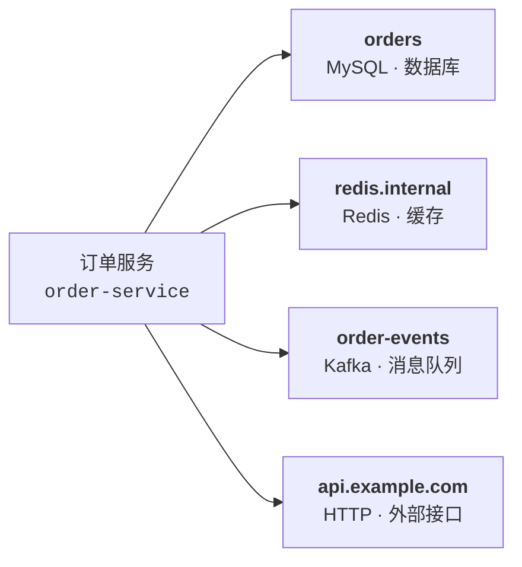
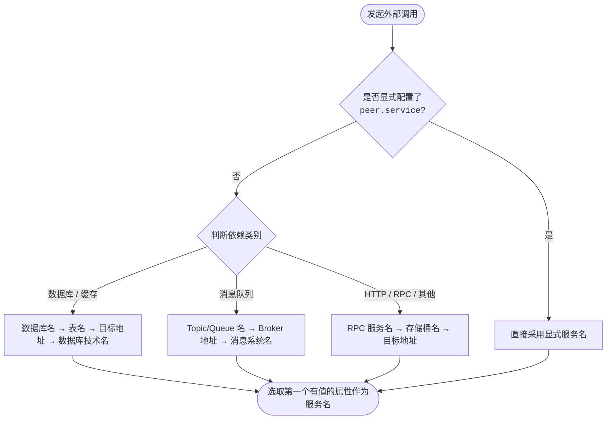

# 推断服务：从调用记录识别应用依赖

在分布式微服务架构中，应用经常需要调用数据库、缓存、消息队列或第三方外部 API。在很多场景下，这些被调用的对端系统**并未（或无法）接入链路追踪（Tracing）**。

**推断服务（Inferred Services）**通过分析应用自身上报的出站调用记录（Span），自动发现并推断出这些下游依赖，在**服务依赖拓扑图（Dependency Map）**、**服务目录（Catalog）**与调用链中自动呈现它们的**服务名称**、**底层技术**与**依赖类型**，无需人工手动改写服务名。

例如，订单服务发起了一次 MySQL 查询。即使 MySQL 本身没有上报追踪数据，只要客户端记录了数据库类型和库名，系统就能在拓扑图上自动绘制出名为 `orders` 的 MySQL 依赖节点。

---

## 1. 核心概念：三个识别维度

对每一次外部调用，系统会独立解析出三个维度的信息，互不冲突：

| 维度 | 回答的问题 | 呈现与用途 | 典型示例 |
| :--- | :--- | :--- | :--- |
| **推断服务名称** | **访问哪个具体依赖？** | 拓扑图节点名称、依赖列表筛选项 | `orders`、`order-events`、`api.example.com` |
| **技术（technology）** | **底层使用什么协议或引擎？** | 性能钻取、中间件与驱动分析 | `mysql`、`redis`、`kafka`、`grpc`、`http` |
| **类型（entity_type）** | **宏观上属于哪一类依赖？** | 拓扑节点图标（Icon）、高层分组筛选 | 数据库 (`db`)、缓存 (`cache`)、队列 (`queue`)、RPC (`rpc`)、HTTP (`http`) |

> **设计特点**：
> - **技术不合并**：MySQL 与 ClickHouse 都属于数据库 (`db`) 类型，但在技术轴上分别保留 `mysql` 与 `clickhouse`，不粗暴折叠为通用的 "sql"。
> - **缓存独立分类**：Redis、Memcached、Valkey 单独标识为 `cache` 类型，在拓扑图与报表中与持久化数据库清晰区分。

---

## 2. 哪些调用会生成推断服务

系统只对明确代表**与外部对端通信**的调用记录生成推断服务：

### 支持的调用类型
- **客户端调用（Client）**：对外发起的 HTTP、RPC、数据库查询、缓存读写等。
- **消息发送（Producer）**：向消息队列发送消息。
- **消息消费（Consumer）**：从消息队列拉取或处理消息。

> [!NOTE]
> **消息消费（Consumer）的拓扑中介语义**：
> 消费消息时，推断服务代表的是**承载消息的队列中间件（Topic / Queue）**，而不是“生产这条消息的上游应用”。
> 拓扑关系呈现为：`生产应用 ──> [Topic/Queue 节点] <── 消费应用`，推断节点准确反映异步消息解耦关系。

### 不生成推断服务的调用
- **服务端处理（Server）**：应用接收并处理入站请求。此时应使用应用自身的真实服务名，不生成远端推断服务。
- **内部调用（Internal）**：应用内部的方法或本地操作，不存在远端依赖通信。

---

## 3. 服务名称是如何确定的

服务名称的推断遵循**“业务显式定义优先，缺失时从具体到抽象逐级回退”**的原则。

### 3.1 决策流程

### 3.2 依赖实体命名优先级（Precedence of Peer Tags）

当调用记录中包含多个候选属性时，系统按**依赖实体类型**依序回退，选取最高优先级的有效值作为服务名。若最高优先级的属性未采集，系统将自动顺延至次高优先级：

| 依赖实体类型 (Entity Type) | 命名优先级回退链（从高到低） | 常见推断名称示例 |
| :--- | :--- | :--- |
| **数据库与缓存 (Database & Cache)** | `peer.db.name` > `peer.aws.dynamodb.table` > `peer.hostname` > `peer.db.system` | `orders` > `orders-table` > `db-1.internal` > `mysql` |
| **消息队列 (Queue)** | `peer.messaging.destination` > `peer.kafka.bootstrap.servers` / `peer.rocketmq.broker` / `peer.aws.kinesis.stream` > `peer.messaging.system` | `order-events` > `b1:9092` / `broker-a:10911` > `kafka` |
| **外部通用服务 (Inferred Service / RPC / HTTP)** | `peer.service` > `peer.rpc.service` > `peer.aws.s3.bucket` > `peer.hostname` | `payment-api` > `orders.v1.OrderService` > `order-bucket` > `api.example.com` |

> [!IMPORTANT]
> **显式覆盖规则**：`peer.service` 是最高优先级的属性。一旦在 Span 中显式指定，将无条件覆盖上述所有自动推断规则，直接作为服务名称。

### 3.3 信息完整度对名称精度的影响

以 MySQL 为例，客户端上报信息的详略程度决定了推断服务名的精准度：

| 上报信息 | 推断服务名称 | 精度等级 | 呈现效果 |
| :--- | :--- | :--- | :--- |
| 包含数据库名 `orders` + 主机 `db-1.internal` | `orders` | **高（逻辑实体）** | 精准区分业务数据库，不同调用汇聚到对应业务库 |
| 仅包含主机 `db-1.internal` | `db-1.internal` | **中（网络节点）** | 识别到具体机器实例，但无法区分机器内的具体数据库 |
| 仅包含组件类型 `mysql` | `mysql` | **低（技术兜底）** | 所有未上报库名和地址的调用均汇聚到一个叫 `mysql` 的通用节点 |
| 显式配置 `peer.service: order-master` | `order-master` | **自定义（业务视角）** | 业务完全自主掌控显示名称，不受连接信息变动影响 |

> [!TIP]
> **主机地址规则**：以主机地址作为名称兜底时，系统**不拼接端口**（如识别为 `api.example.com` 而非 `api.example.com:443`），防止同一服务的不同连接端口导致节点分散。

---

## 4. Peer 属性与来源对照表（对齐 Datadog Peer Tags）

在分布式追踪中，系统从调用记录的原始属性（Precursor Attributes）中收敛出标准化的 **Peer 属性（`peer.*`）**，用来准确描述下游对端。

参考 [Datadog Inferred Services Peer Tags 规范](https://docs.datadoghq.com/tracing/services/inferred_services/?tab=agentv7600#peer-tags) 并对齐 OpenTelemetry 语义标准，系统支持的完整 Peer 属性清单如下：

| Peer 属性 (`peer.*`) | 对应的来源属性 (Precursor Attributes) | 适用组件 / 含义 | 说明 |
| :--- | :--- | :--- | :--- |
| `peer.service` | `peer.service` | 显式远端服务名 | 业务显式覆盖名称，跨领域最高优先级 |
| `peer.hostname` | `server.address` → `net.peer.name` | 目标主机名 / IP | 远端域名或主机 IP（不带端口） |
| `peer.db.name` | `db.namespace` → `db.name` | 数据库名 | 数据库名或命名空间 |
| `peer.db.system` | `db.system.name` → `db.system` → `db.type` | 数据库技术名 | 数据库系统类型（如 `mysql`, `clickhouse`） |
| `peer.messaging.destination` | `messaging.destination.name` → `messaging.destination` | 消息目的地 | Topic 或 Queue 名称 |
| `peer.messaging.system` | `messaging.system` | 消息中间件名 | 消息系统类型（如 `kafka`, `rabbitmq`） |
| `peer.kafka.bootstrap.servers`| `messaging.kafka.bootstrap.servers` | Kafka 集群地址 | Kafka Broker 地址列表 |
| `peer.rocketmq.broker` | `messaging.rocketmq.broker_address` | RocketMQ Broker | *(常用扩展)* RocketMQ Broker 地址 |
| `peer.rpc.service` | `rpc.service` | RPC 服务全名 | RPC 接口服务名（如 `orders.v1.OrderService`） |
| `peer.rpc.system` | `rpc.system.name` → `rpc.system` | RPC 框架名 | RPC 协议类型（如 `grpc`, `dubbo`） |
| `peer.aws.s3.bucket` | `aws.s3.bucket` | S3 存储桶名 | AWS S3 Bucket 名称 |
| `peer.aws.dynamodb.table` | `aws.dynamodb.table_names` | DynamoDB 表名 | AWS DynamoDB 目标表名 |
| `peer.aws.kinesis.stream` | `aws.kinesis.stream_name` | Kinesis 流名 | AWS Kinesis 数据流名称 |
| `peer.aws.sqs.queue` | `messaging.destination.name` | SQS 队列名 | SQS 队列名统一归入消息目的地 |
| `otelmap.flattened.peer.tags` | *(由上述属性组合生成)* | 拓扑指纹 | 将当前生效的 `peer.*` 拼接为唯一指纹串 |

> [!NOTE]
> **关于 Datadog 私有属性与 IP 处理的对比**：
> 1. **私有属性剔除**：Datadog 官方文档中的 `peer.cassandra.contact.points`、`peer.couchbase.seed.nodes` 以及 `_dd.base_service` 属于 Datadog 探针的私有属性，OpenTelemetry 标准语义规范中无对应属性，本系统未引入此类私有标签，全面拥抱 OpenTelemetry 原生规范。
> 2. **IP 地址处理**：Datadog 会将匹配 IP 地址格式的属性统一脱敏为 `blocked-ip-address` 防止高基数；本项目默认**保留 IP 原值**（如 `10.0.12.34`），方便研发和运维直接排查网络问题；基数控制建议在前置采集管道或通过环境维度进行聚合。

---

## 5. 如何让识别更准确（接入建议）

若发现拓扑图中的依赖节点名称不够清晰，可通过以下方式进行优化：

1. **补全关键属性**：
   - **数据库**：确保连接配置或探针能够采集到数据库名（`db.namespace` 或 `db.name`）。
   - **消息队列**：确保上报了 Topic 或 Queue 名称（`messaging.destination.name`）。
   - **外部 HTTP 调用**：优先使用语义清晰的域名连接，避免直接使用裸 IP。
2. **显式配置服务名（推荐）**：
   如果希望在微服务视角下呈现统一、可读的业务名称，可在客户端 SDK、拦截器或网关配置中注入 `peer.service`。

---

## 6. 常见问题解答（FAQ）

### Q1：为什么拓扑图上出现了很多独立的 IP 节点？
- **原因**：调用时未采集到数据库名、Topic 名或域名，系统回退到了目标 IP 地址。
- **解决**：在连接串中补齐数据库名，或将外部接口调用地址改为域名连接，或显式配置 `peer.service`。

### Q2：为什么所有数据库调用都连到了一个叫 `mysql` 的节点？
- **原因**：调用记录中既没有数据库名，也没有目标主机地址，推断降级到了最低优先级的技术名兜底。
- **解决**：检查并升级客户端 OpenTelemetry 驱动插件，开启连接与库名属性自动采集。

### Q3：为什么 RPC 依赖节点显示为接口全类名（如 `com.example.OrderService`）？
- **原因**：未配置逻辑微服务名时，系统默认选取了协议层的 RPC 接口服务名。
- **解决**：如希望直接显示为部署层面的应用名（如 `order-service`），可在客户端拦截器中设置 `peer.service: order-service`。

### Q4：为什么消费 Kafka 时，下游节点显示的是 Topic 而不是生产方应用？
- **原因**：消息队列天然具备异步解耦特性。消费者只能确认自身是从哪个 Topic 拉取消息，单次消费无法直接获知是哪台上游机器生产的。
- **解决**：拓扑中呈现为 `生产者 → Topic → 消费者`，符合真实的分布式消息流转模型。

---

## 7. 与 Datadog 的对照参考

本项目在借鉴业界成熟经验的同时，针对常见场景做了实用优化：

| 维度 | Datadog 表现 | 本项目表现 | 产品优势 |
| :--- | :--- | :--- | :--- |
| **缓存分类** | 与数据库统一合并为 `datastore` | 独立划分为 `cache` | 缓存与数据库在拓扑图中有不同的专属图标与过滤维度 |
| **技术归一** | 粗粒度合并（如所有 SQL 库合并为 `sql`） | 保留独立引擎（`mysql`, `clickhouse` 等） | 精准识别底层中间件，方便性能对比与引擎级筛选 |
| **消息中间件** | 支持 Kafka / SQS 等标准组件 | 原生扩展支持 RocketMQ | 更好地覆盖常用消息中间件生态 |
| **IP 兜底处理** | 将 IP 地址重命名为 `blocked-ip-address` | 保留 IP 原值 | 方便运维与研发直接依据 IP 排查网络连接问题 |

---

*文档版本：2026-09-18*
