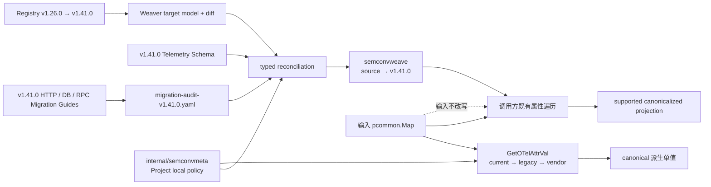
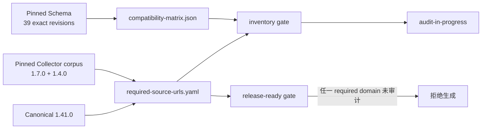
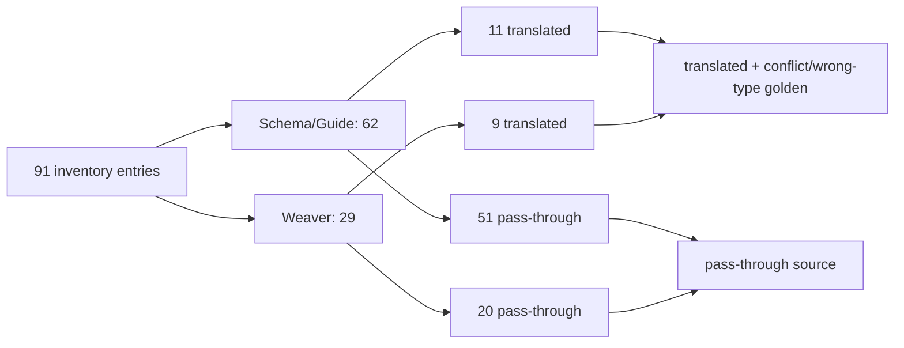
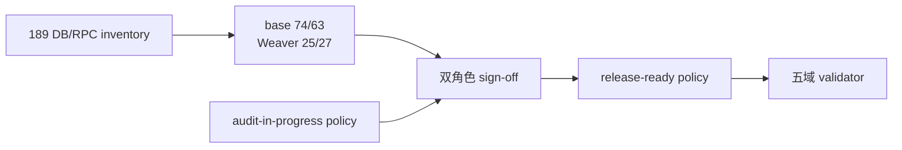
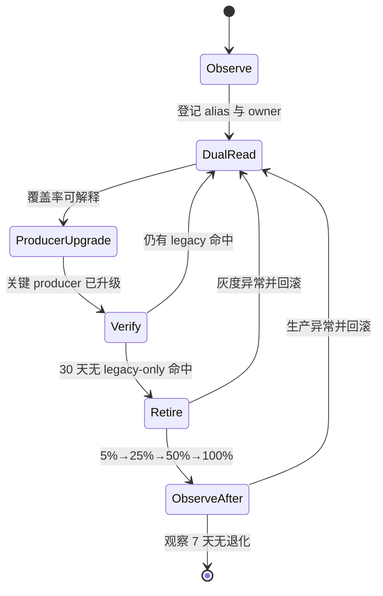

# SemConv 兼容策略：以 v1.41.0 为目标，getter 与属性 Weave 共享本地 policy

**决策日期：** 2026-07-22<br>
**状态：** getter 与完整属性 Weave 已实现，公开快照，版本以本仓库发布的 tag 为准<br>
**适用范围：** `otlpmap` 实际消费的 Span/Resource 属性，以及已实现的 trace canonical projection

## 结论：canonical 固定为 v1.41.0

本项目选择 **OpenTelemetry Semantic Conventions v1.41.0** 作为 canonical 目标，Schema URL 为
`https://opentelemetry.io/schemas/1.41.0`。

选择依据有三点：

1. 当前依赖 `go.opentelemetry.io/otel v1.44.0` 已内置 `semconv/v1.41.0`，构建无需增加依赖。
2. v1.41.0 覆盖 DB 稳定化后的 key/value、RPC v1.39 rename，以及已稳定的
   `deployment.environment.name`。
3. 当前源码使用的 v1.34 key 在 v1.41.0 中保持同名；切换治理目标不会改变公开 API。

canonical 表示 getter 输出和持久化属性 projection 的统一词汇目标。核心不原地改写输入 OTLP
attributes，也不会根据 `schema_url` 创建动态处理器。已实现的 `semconvweave` 根据 SchemaURL
选择构建期生成的静态 weave，调用方在既有遍历中生成 canonical 输出。v1.41.1 及更高版本只有在完成
Schema diff、重新生成、契约审核和性能回归后，才能成为新的 canonical。



## 支持边界分成 getter 概念窗口与 trace projection 清单

现有 getter 只兼容实际消费的属性。某个 Schema URL 被标记为 `supported-legacy`，表示下表中的旧 key
可被定向读取，不表示该 Schema 的所有属性都能迁移到 v1.41.0。

`semconvweave` 扩展到经评审的 trace projection 清单：Resource、Span、Span Event 的
key/name rename，以及登记的 string value rename。它不处理 metrics/logs，不承诺任意 Schema
operation，也不把 split 或 context-dependent 重构伪装成 1:1 rename。支持的 source Schema URL
必须由生成 manifest 明确列出。首期 manifest 来自固定 checksum 的 v1.41.0 official Schema：
39 个 exact revision，从 `1.4.0` 到 `1.41.0`，不使用开放 SemVer 区间，也不翻译 vendor
Schema family。39 个 revision 是 Schema 可表达覆盖清单，不是完整语义迁移声明。

| 领域 | canonical 代际 | 支持的 legacy 代际 | 边界依据 |
| --- | --- | --- | --- |
| DB | v1.41.0；`db.system.name`、`db.query.text` | `db.system`（Go semconv ≤v1.28）、`db.statement`（≤v1.25）及 `db.type` vendor alias | DB 稳定迁移；v1.33 首次稳定，项目现用 v1.34 常量 |
| HTTP/URL | v1.41.0；HTTP stable v1.23.1 词汇 | v1.20 及更早语义；Go 包为双发迁移保留旧 key 到 v1.25 | HTTP stability migration |
| Messaging | v1.41.0 | `messaging.destination`（≤v1.16）、`messaging.operation`（≤v1.25） | Go semconv 生成包的 key 生命周期 |
| Deployment | v1.41.0；`deployment.environment.name` 在该版本稳定 | `deployment.environment`（≤v1.26） | 新 key 从 v1.27 起提供 |
| RPC | v1.41.0；采用 v1.39 词汇 | v1.38 及更早的 `rpc.system`、拆分式 `rpc.service` | RPC v1.39 migration |
| FaaS / GraphQL | v1.41.0 | 当前没有登记 legacy alias | 已消费 key 在审核区间内未改名 |
| Network | v1.41.0；`network.protocol.name` | v1.20 的 `net.protocol.name` | HTTP/network stability migration |
| Override | 项目自有契约 | DataDog 风格 `operation.name`、`resource.name` | 不属于 OTel Schema |

版本观测使用四个低基数状态：

- `canonical`：Schema URL 明确为 v1.41.0。
- `supported-legacy`：版本已知，且其被消费概念落在上表的定向兼容范围。
- `missing`：Resource/Scope 未提供 Schema URL。
- `unknown`：URL 无法解析或版本未审核；原始 URL 不进入常规 metric label。

`missing` 与 `unknown` 不改变运行时 fallback。Resource/Scope 层的聚合、诊断预算与迁移流程见
[SemConv 版本观测与迁移手册](./semconv-observability-runbook.md)。

对完整属性 projection：

- `canonical` 不执行 Schema revision；合法 canonical key/name 走 no-op，已审核的全局 alias
  fallback 仍可处理 URL 与 payload 不一致的 producer；
- 已登记 `supported-legacy` 使用精确 source → v1.41.0 weave；
- `missing` / `unknown` 只使用下表已审核的单向 alias fallback；
- vendor alias 不依赖 SchemaURL，不会因为 URL 为 canonical 就自动禁用。

### Required URL 由固定语料决定，不等于 39 个候选全部支持

Story 7.4 把兼容范围拆成两个独立集合：

- compatibility matrix 从 checksum-locked v1.41.0 Telemetry Schema 精确提取 39 个 revision；
- required policy 只包含 canonical `1.41.0`，以及固定 Collector 回归/基准语料实际出现的
  `1.7.0`、`1.4.0`。

其余 36 个 revision 保持 `optional/unknown`，不会进入 runtime lookup。required 也不自动等于
release-ready：canonical 的五个 trace domain 是 `canonical_noop`；`1.7.0`、`1.4.0` 先在
draft 中保持 `manual_audit_required`，只有 HTTP/DB/RPC audit 与双签核闭合后才提升为完整域策略。



生成和独立校验命令如下；策略文件使用 canonical JSON（YAML 1.2 子集），因此 strict decoder
能够拒绝 unknown field、重复项、缺失证据和开放版本范围：

```bash
GOWORK=off go -C tools/semconv-weave-gen run ./cmd/generate-url-policy
GOWORK=off go -C tools/semconv-weave-gen run ./cmd/validate-url-policy
GOWORK=off go -C tools/semconv-weave-gen run ./cmd/validate-url-policy -release-ready
```

第一条命令只重建 `required-source-urls-draft.json`；Story 7.6 的 signed combined audit generator
将其提升为 `required-source-urls.yaml`。当前第三条命令已经通过。对 draft 显式使用
`-policy testdata/audit/required-source-urls-draft.json -release-ready` 仍必须失败。Story 7.9 的
最终 compiler 必须调用 release-ready gate。

### HTTP/URL/Network audit 已关闭 91 项 inventory

Story 7.5 从三类固定输入生成 91 项 inventory：Telemetry Schema trace operations 29 项、真实
`v1.26.0→v1.41.0` Weaver diff relevant candidate 29 项，以及 HTTP Migration Guide 的 span
表格、旧版本附注和 span-name 小节 33 项。`http-url-network-obligations.json` 是机器提取的并集，
`http-url-network-decisions.json` 保存 62 项 Schema/Guide disposition 与 29 项 Weaver signed
action，二者共同进入 compiler reconciliation。

Schema/Guide catalog 有 11 项一对一 key rename 被批准为 `pure_rename/translated`，包括
`http.status_code`、`http.url`、`http.resend_count`、`http.user_agent`。Weaver catalog 另有
9 项 translated、20 项 pass-through。signed `translated` 仍只是候选授权：target model 会拒绝
deprecated intermediate key，因此
`net.app.protocol.name→net.protocol.name→network.protocol.name` 不再以 deprecated
`net.protocol.name` 进入 executable IR；无法安全形成 direct final mapping 时保留 source。

其余 51 项保持 `pass_through`，重点包括：

- `http.target` 的 path/query split；
- `http.method` 的 `_OTHER` 与 `http.request.method_original` 协议；
- 依赖 Forwarded headers 的 `http.scheme`；
- client/server side 才能决定目标的 address/port；
- requirement/stability/removed/new-field 变化；
- 依赖 method、route 和 `_OTHER` 的 HTTP span-name 重算。



审核可重复生成与独立校验：

```bash
GOWORK=off go -C tools/semconv-weave-gen run ./cmd/generate-http-audit
GOWORK=off go -C tools/semconv-weave-gen run ./cmd/validate-http-audit
```

HTTP 审核本身不单独关闭 required URL 的五域状态；Story 7.6 已在 DB/RPC 审核与双人 sign-off
完成后统一关闭。

### DB/RPC audit 与 root alias contract 已双向闭合

Story 7.6 的 DB/RPC inventory 为 189 项：Telemetry Schema 37 项、DB Guide 53 项、RPC Guide
28 项、root `canonicalizeTechnology` contract 19 项，以及真实 Weaver diff relevant candidate
52 项。原 Schema/Guide/root catalog 为 74 translated / 63 pass-through；Weaver catalog 为
25 translated / 27 pass-through。

DB system key 与 value 分开审核；18 个仍有官方 target 的 DB/RPC alias 与 Guide 双向一致。
`cache` 虽是现有 getter compatibility alias，但 Guide 已标 Removed，因此完整 attribute projection
保留 source/custom value。以下变化也明确不生成 canonical target：

- `db.statement → db.query.text`：缺少 sanitization 等价证明；
- DB span name、`db.name` merge、多个 collection source：需要上下文或 winner；
- `rpc.method + rpc.service`：无法无损重算 fully-qualified method；
- `rpc.grpc.status_code`：int→string enum；
- deprecated RPC event/name 与 requirement/stability changes。

classifier maintainer 与 semantic reviewer 两个固定 sign-off 同时绑定 DB/RPC Guide checksum、
inventory digest 和 draft policy digest。签核后历史 required URL 的状态为：

| domain | disposition |
| --- | --- |
| Resource / Span / Span Event | `translated`（包含显式 pass-through obligation） |
| Span name / Event name | `pass_through` |



### Migration Guide 审计定义 Schema 之外的边界

Telemetry Schema 文件是 weave generator 的机器输入；与 target 同 tag 的 HTTP、DB、RPC Migration
Guides 是人工审计输入。维护者必须把每一项相关变化登记到
`migration-audit-v1.41.0.yaml`，并选择以下一种处理：

| 分类 | 默认处理 |
| --- | --- |
| 纯 rename | 允许生成静态一跳 weave |
| 确定性 enum/value rename | 允许生成静态 value map |
| split/merge | source 原样透传，不生成 target |
| context/recompute | 由 producer/Agent 发出新语义；weave 不解析或猜测 |
| removed/requirement/stability | 显式登记 policy；未批准 drop 时原样透传 |
| producer dual emit | target/new 胜出，非重叠属性保留，冲突进入 golden |

这一区分会阻止四类误迁移：不能把 `http.target` 直接改名成任一 URL 子属性；不能把任意
`http.method` 只改 key 而遗漏非标准 method 的 `_OTHER` + original 契约；不能在没有 sanitization
证明时把 `db.statement` 宣称为 `db.query.text`；不能只靠属性 rename 推导新的 HTTP/DB span
name。默认透传不覆盖独立的 PII 与落库准入策略。

### 覆盖率分域统计，并按处理 Span 数量加权

版本覆盖率使用两组独立计数器，二者不合并，也不存在覆盖优先级：

- **Span 派生覆盖率**使用 `ScopeSpans.schema_url`，对应 `GetTechnology`、`GetEntityType`、
  `GetOperationName`、`GetResourceName` 和 `GetDBQueryText` 消费的 Span 属性。
- **Resource 派生覆盖率**使用 `ResourceSpans.schema_url`，对应 `GetServiceName`、
  `GetDeploymentEnvironmentName` 和 `GetServiceVersion` 消费的 Resource 属性。

调用方在批边界解析一次 Schema URL，再用该分组包含的 Span 数量增加计数。这样保留流量权重，
同时避免逐 Span 解析：

```text
for each ResourceSpans:
    resource_weight = ResourceSpans 下所有 ScopeSpans 的 Span 总数
    resource_schema_state[classify(ResourceSpans.schema_url)] += resource_weight

    for each ScopeSpans:
        span_weight = ScopeSpans 下的 Span 数量
        span_schema_state[classify(ScopeSpans.schema_url)] += span_weight
```

两组覆盖率都以各自计数器中的处理 Span 总数为分母。一个 Span 会分别贡献一次 Span 派生计数和
一次 Resource 派生计数；两个 Schema URL 同时存在时仍各自归类。所有生产区域的两组覆盖率都通过
门槛，才能进入 legacy alias 退出流程。

## Key 支持矩阵以实际函数为准

表中顺序就是 `GetOTelAttrVal()` 的运行时顺序。`current` 有非空值时胜出；present-empty
视为缺失，继续读取下一个 alias。函数缩写：T=`GetTechnology`，ET=`GetEntityType`，
O=`GetOperationName`，R=`GetResourceName`，E=`GetDeploymentEnvironmentName`，S=`GetServiceName`，
V=`GetServiceVersion`，Q=`GetDBQueryText`。

这张表证明 getter 能读取哪些旧 key，不自动授权 `semconvweave` 把旧 key 重写为新 key。凡是
Migration Guide 同时改变来源、requirement、值域或上下文（例如 forwarded-header 参与 URL scheme
计算），都必须先通过 migration audit；否则 getter 可 fallback，完整属性 projection 仍透传 source。

| 领域/概念 | v1.41 canonical key | legacy/vendor fallback | 当前消费者与顺序 | 当前状态 |
| --- | --- | --- | --- | --- |
| DB system | `db.system.name` | `db.system` → `db.type` | T/ET/O/R：current → legacy → vendor | 支持；`db.type` 为全库兼容 |
| DB query | `db.query.text` | `db.statement` | Q/R：current → legacy | getter fallback 支持；weave 不做无条件 rename，R 依赖发行版 Agent 预清洗 |
| Messaging system | `messaging.system` | 无 | T/ET/O | 支持 |
| Messaging operation | O：`messaging.operation.type`；R：`messaging.operation.name` | `messaging.operation` | O/R 各自 current → legacy | 支持 |
| Messaging destination | `messaging.destination.name` | `messaging.destination` | R：current → legacy | 支持 |
| RPC system | `rpc.system.name` | `rpc.system` | T/ET/O：current → legacy；输出 canonical value | 支持 |
| RPC method | `rpc.method`（v1.39 起为全限定名） | 无 | R | 支持 |
| RPC service | 已并入 `rpc.method` | `rpc.service`（≤v1.38） | R：DD 格式 `method service` | 支持 legacy 组合 |
| HTTP method | `http.request.method` | `http.method` | T/ET 的 HTTP marker、O、R | getter fallback 支持；weave 首期不把任意 legacy method 当纯 rename |
| HTTP response status | `http.response.status_code` | `http.status_code` | O：current → legacy，仅作为 HTTP marker | 支持 |
| HTTP route | `http.route` | 无 | R：仅 server | 支持 |
| URL full | `url.full` | `http.url` | T/ET 的 HTTP marker | 支持 |
| URL scheme | `url.scheme` | `http.scheme` | T/ET 的 HTTP marker | 支持 |
| URL template | `url.template` | 无 | R：仅 client | 支持 |
| Deployment env | `deployment.environment.name` | `deployment.environment` | E：current → legacy | 支持 |
| FaaS trigger | `faas.trigger` | 无 | ET/O | 支持 |
| FaaS invoked name | `faas.invoked_name` | 无 | ET/O | 支持 |
| FaaS provider | `faas.invoked_provider` | 无 | O | 支持 |
| GraphQL operation type | `graphql.operation.type` | 无 | O/R | 支持 |
| GraphQL operation name | `graphql.operation.name` | 无 | R | 支持 |
| Network protocol | `network.protocol.name` | `net.protocol.name` | O：current → legacy | 支持 |
| Service name | `service.name` | 无 | S | 支持 |
| Service version | `service.version` | 无 | V | 支持 |
| Operation override | 无 OTel 等价项 | `operation.name` | O：最高优先级 | 项目/vendor 契约 |
| Resource override | 无 OTel 等价项 | `resource.name` | R：最高优先级 | 项目/vendor 契约 |

## Value 归一覆盖已知 DB/RPC rename

DB 官方迁移把产品名收敛到 `<vendor>.<product>`。下表记录所有有明确 canonical 目标且与本库有关的
rename；没有替代项的旧值继续原样透传，避免虚构产品身份。

| legacy value | v1.41 canonical value | 当前 `canonicalizeTechnology` |
| --- | --- | --- |
| `adabas` | `softwareag.adabas` | 已实现 |
| `intersystems_cache` | `intersystems.cache` | 已实现 |
| `cache` | `intersystems.cache` | 已实现；项目兼容桥，官方将旧 alias 标为 removed |
| `cosmosdb` | `azure.cosmosdb` | 已实现 |
| `db2` | `ibm.db2` | 已实现 |
| `dynamodb` | `aws.dynamodb` | 已实现 |
| `firebird` | `firebirdsql` | 已实现 |
| `h2` | `h2database` | 已实现 |
| `hanadb` | `sap.hana` | 已实现 |
| `informix` | `ibm.informix` | 已实现 |
| `ingres` | `actian.ingres` | 已实现 |
| `maxdb` | `sap.maxdb` | 已实现 |
| `mssql` | `microsoft.sql_server` | 已实现 |
| `netezza` | `ibm.netezza` | 已实现 |
| `oracle` | `oracle.db` | 已实现 |
| `redshift` | `aws.redshift` | 已实现 |
| `spanner` | `gcp.spanner` | 已实现 |

RPC v1.39 另有两项明确 rename：

| legacy value | v1.41 canonical value | 当前状态 |
| --- | --- | --- |
| `apache_dubbo` | `dubbo` | 已实现 |
| `connect_rpc` | `connectrpc` | 已实现 |

`java_rmi`、`dotnet_wcf`、`onc_rpc` 从官方枚举移除，但规范允许它们作为 custom value。本项目保留原值。
`GetTechnology` 与 `GetOperationName` 共用该 canonicalization；`GetResourceName` 不输出 system 前缀，
并按 DD 格式把 legacy `rpc.service` 追加为 `method service`。

## Legacy 字面量必须有来源和退出路径

下表覆盖 `keys.go` 中全部手写兼容字面量。由官方旧版常量表达的 `db.system`、`rpc.system` 不在此表
重复登记。

| 字面量 | 类型与来源 | canonical 目标 | 消费函数 | 保留理由 |
| --- | --- | --- | --- | --- |
| `db.type` | DataDog/vendor integration | `db.system.name` | T/ET/O/R | 兼容既有 vendor emitter；全库按第三优先级读取 |
| `http.method` | HTTP ≤v1.20 | `http.request.method` | T/ET/O/R | 官方 HTTP 双发迁移窗口 |
| `http.status_code` | HTTP ≤v1.20 | `http.response.status_code` | O | 兼容仅携带响应状态码的旧 HTTP span |
| `http.url` | HTTP ≤v1.20 | `url.full` | T/ET HTTP marker | 官方 HTTP client rename |
| `http.scheme` | HTTP ≤v1.20 | `url.scheme` | T/ET HTTP marker | 官方 HTTP server rename |
| `messaging.operation` | Go semconv ≤v1.25 | O：`messaging.operation.type`；R：`messaging.operation.name` | O/R | 兼容旧 messaging operation |
| `messaging.destination` | Go semconv ≤v1.16 | `messaging.destination.name` | R | 兼容旧 destination key |
| `db.statement` | DB v1.24 代际；Go semconv ≤v1.25 | `db.query.text` | Q/R | 兼容数据库稳定迁移；进入 R 前由发行版 Agent 完成 query sanitization |
| `deployment.environment` | Go semconv ≤v1.26 | `deployment.environment.name` | E | 兼容 resource environment rename |
| `net.protocol.name` | HTTP/network ≤v1.20 | `network.protocol.name` | O | 官方 HTTP/network 稳定迁移窗口 |
| `operation.name` | DataDog/project override | 无 OTel 等价项 | O | 公开派生行为的一部分；按 API 版本治理 |
| `resource.name` | DataDog/project override | 无 OTel 等价项 | R | 公开派生行为的一部分；按 API 版本治理 |

官方 legacy alias 与 vendor alias 分开退出。Schema URL 只能辅助判断前者；vendor alias 必须结合实际
命中率和调用方清单。

## 规则退出采用“观测、确认、灰度、可回滚”四道门

每条 alias 独立退出，不做批量清空。满足以下全部条件后，维护者才能提交删除 PR：

1. **覆盖率可解释**：所有生产区域的 Span 派生覆盖率和 Resource 派生覆盖率分别连续 30 天满足
   `canonical + supported-legacy` ≥99.9%，且各自的 `missing + unknown` ≤0.1%。
2. **旧规则无实际依赖**：同一窗口内，批内聚合或采样诊断没有发现 legacy-only 命中；发生过任何
   命中就重新计时。vendor alias 还必须取得全部登记调用方确认。
3. **重要调用方确认**：流量、收入或合规清单中的关键 producer 100% 确认已升级，并提供可追踪的
   owner 与版本证据。
4. **删除可单独回滚**：一个 PR 只删除一组同源 alias，同时更新契约测试和 benchmark；保留上一版
   可部署产物，能够通过 revert 恢复。
5. **灰度无退化**：5% 流量至少 24 小时，再按 25% → 50% → 100% 放量；technology/entity_type
   空值率、fallback 率和 backpressure 不得恶化。

删除后观察 7 天。若 canonical 输出缺失率上升、unknown 激增或关键调用方报告误分类，立即回滚该
alias 删除，不等待下一个 SemConv 升级。



## Canonical 升级必须显式评审

升级 canonical 版本需要一个独立 Story，并同时满足：

1. 当前 `go.opentelemetry.io/otel` 依赖包含目标 `semconv/vX.Y.Z` 包。
2. 固定目标 release/tag 下的 Schema 与 HTTP、DB、RPC Migration Guides，记录 checksum。
3. 对本文件全部 key/name/value 执行版本 diff，并更新人工 migration audit，记录 rename、split、
   context/recompute、removed、requirement、stability、enum 与 owner；禁止未分类项进入生成结果。
4. 重新生成所有 source → target weave，更新支持/例外 manifest、静态矩阵、golden、契约测试和 benchmark；
   canonical/no-op 与 Resolve 路径保持 0 alloc。
5. 在调用方代表性负载下重新执行 调用方目标吞吐量 容量验收。
6. 更新 ADR、架构、开发指南和版本观测分类。

SemConv 新版本发布不会自动改变本项目 canonical。输入 `pcommon.Map` 保留在调用方，因此生成或
调用失败不会污染同一批 pdata；持久化属性列的 target 版本仍需和 classifier tag 一起固定。

## 完整属性 Weave 的规则补充

`semconvweave` 实现后遵守以下优先级：

```text
canonical/current > newer legacy > older legacy > vendor fallback
```

遍历 legacy key 时，如果输入 Map 已存在更高优先级 key，则不输出该 legacy value。这样结果不依赖
`pcommon.Map.Range` 的遍历顺序。未登记 key/value 原样透传；只有登记的 string value 才进入静态
canonicalization。Project 不为尚未上线的自身链路启用 migration/copy mode；producer 仍可能按
`http/dup`、`database/dup` 或未来 `dual_emit` 双发，因此 target/new 必须稳定胜出。

SchemaURL 层级固定为：

- Resource attributes 使用 `ResourceSpans.SchemaURL`；
- Span/Event 使用 `ScopeSpans.SchemaURL`，为空时回退 Resource URL；
- Resolve 在 Resource/Scope 边界执行一次，不逐 Span 解析。

详细包边界、生成器错误条件和性能门禁见
[Schema 归一化设计](weaver-build-contract.md)。

## Story 6.3 审计结果

| ID | 审计发现 | Story 6.3 处理结果 |
| --- | --- | --- |
| G1 | `db.type` 只进入 T/ET，不进入 O/R | 已采用全库兼容，四个 Span 派生函数按同一 DB key 顺序读取 |
| G2 | DB value map 缺少 `db2→ibm.db2`、`h2→h2database` | 已补官方常量映射与测试 |
| G3 | RPC value map 缺少 `apache_dubbo→dubbo`、`connect_rpc→connectrpc` | 已补官方常量映射与测试 |
| G4 | O 只读 `network.protocol.name`，未读 `net.protocol.name` | 已静态双读并覆盖冲突、present-empty 测试 |
| G5 | 多数 current key 仍从 v1.34 包取常量 | current key 已统一引用 v1.41；移除项保留旧版常量/登记字面量 |
| G6 | O 使用未归一 DB/RPC value 拼 operation 前缀 | DB/RPC operation 前缀已共用 `canonicalizeTechnology` |
| G7 | v1.39 将 `rpc.service` 并入全限定 `rpc.method` | 兼容诊断仍规范化比较；Resource 按 DD 输出 `method service` |

## 参考资料

- [OpenTelemetry Go semconv/v1.41.0](https://pkg.go.dev/go.opentelemetry.io/otel/semconv/v1.41.0)
- [OpenTelemetry Semantic Conventions v1.41.0 release](https://github.com/open-telemetry/semantic-conventions/releases/tag/v1.41.0)
- [Database stability migration v1.41.0](https://github.com/open-telemetry/semantic-conventions/blob/v1.41.0/docs/non-normative/db-migration.md)
- [HTTP stability migration v1.41.0](https://github.com/open-telemetry/semantic-conventions/blob/v1.41.0/docs/non-normative/http-migration.md)
- [RPC stability migration v1.41.0](https://github.com/open-telemetry/semantic-conventions/blob/v1.41.0/docs/non-normative/rpc-migration.md)
- [Semantic Convention version selection](https://opentelemetry.io/docs/specs/semconv/configuration/version-selection/)
- [Deployment attribute registry](https://opentelemetry.io/docs/specs/semconv/registry/attributes/deployment/)
- [Messaging attribute registry](https://opentelemetry.io/docs/specs/semconv/registry/attributes/messaging/)
- [Honeycomb migration case](https://www.honeycomb.io/blog/managing-opentelemetry-semantic-convention-migrations-collector)
- [OpenTelemetry Schema Processor](https://github.com/open-telemetry/opentelemetry-collector-contrib/tree/main/processor/schemaprocessor)
- [OpenTelemetry Telemetry Schemas](https://opentelemetry.io/docs/specs/otel/schemas/)
- [Schema 归一化设计](weaver-build-contract.md)
