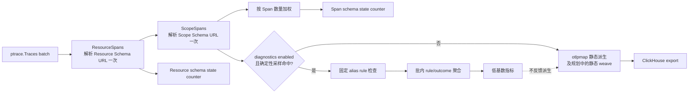
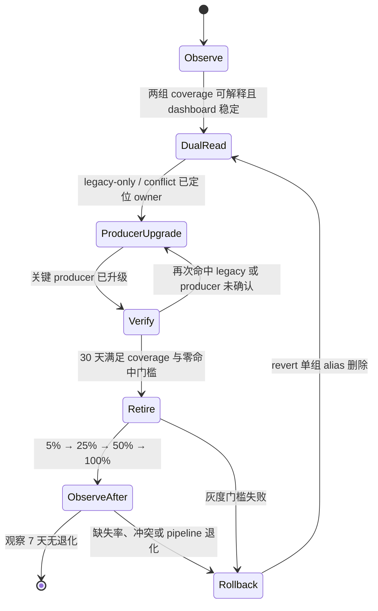

# SemConv 版本观测与 legacy 迁移运行手册

**适用 canonical：** OpenTelemetry Semantic Conventions v1.41.0

**核心边界：** 观测位于 Project Collector 调用方；`otlpmap` 不引入 metrics/logging SDK

**执行 Owner：** 调用方维护者与 调用方值班人员

## 结论：按批观测版本，按样本诊断 alias，核心派生保持静态

版本覆盖率在 OTLP 原生层级统计：Span 派生使用 `ScopeSpans.schema_url`，Resource 派生使用
`ResourceSpans.schema_url`。两组计数器各自以所含 Span 数量加权，不能合并成一个“总体版本率”。

legacy key 命中与冲突诊断默认关闭；开启时在调用方使用确定性低比例采样和固定枚举的批内计数。
诊断结果不参与 `GetTechnology`、`GetEntityType`、`GetOperationName` 或 `GetResourceName` 的决策，
也不改变 missing/unknown 流量的静态 fallback。

已实现的 `semconvweave` 沿用同一观测边界：版本状态指标记录 OTLP 原生 Resource/Scope URL，
weave 选择则按 OTel trace 处理语义让空 Scope URL 回退 Resource URL。两者必须分别命名，不能把
“原生 Scope URL 缺失”和“有效 weave 仍可解析”混成一个状态。

Project 当前系统尚未上线，因此不为自身历史数据启用 upstream migration/copy mode，也不设计
one-hop 双写和回滚窗口。但 producer 可能按 `http/dup`、`database/dup` 或未来 `dual_emit` 同时
发送 old/new 属性；这类输入按现有 `both-same` / `both-conflict` 诊断，投影结果始终以 target/new
为准。



## 一、不可破坏的边界

调用方实现必须同时满足以下约束：

1. 一个 `ScopeSpans` 的 Schema URL 只分类一次；一个 `ResourceSpans` 的 Schema URL 只分类一次。
2. 计数权重是分组所含 Span 数量。零 Span 分组不贡献计数或分母。
3. Span 与 Resource 使用独立计数器、独立分母、独立 SLO；该指标不让 Resource URL 覆盖原生
   Scope URL。运行时 `semconvweave` 可在 Scope URL 为空时使用 Resource URL，两者是不同契约。
4. 常规 metric label 不包含原始 Schema URL、attribute value、service name 或其他无界值。
5. 不输出逐 Span 日志。诊断只产生批内固定枚举计数，以及受容量限制的 unknown URL 诊断缓冲。
6. diagnostics 可以通过 feature flag 完全关闭；关闭不改变任何派生字段。
7. 本核心仓不新增 metrics/logging SDK、动态 Schema registry、网络下载或属性 Map 重写。
8. Schema URL 为 supported 只说明存在可执行 weave，不证明 Migration Guide 中的 split、重算或
   清洗前置条件已经满足；支持/例外结论来自同 tag 的静态 audit manifest。

## 二、Schema 状态分类契约

### 四个固定状态

| state | 判定 | 运行时行为 |
| --- | --- | --- |
| `canonical` | URL 与 `https://opentelemetry.io/schemas/1.41.0` 精确匹配 | 不执行 Schema revision；合法 canonical key/name 为 no-op，安全全局 alias 仍可 fallback |
| `supported-legacy` | URL 在对应 domain 经评审的 exact allowlist 中 | getter 使用静态 fallback；weave 只执行 audit 批准的 source→target 规则，unsupported 属性透传 |
| `missing` | URL 为空 | 使用已审核的静态 fallback；Span weave 可按独立规则回退 Resource URL |
| `unknown` | URL 非空，但格式错误、来源非官方或不在 allowlist | 使用已审核的静态 fallback；阻断 alias 退出 |

Span 与 Resource 分别维护 allowlist，因为二者消费的概念不同。allowlist 是版本控制下的精确 URL
集合，不接受“版本小于 1.41 都算支持”的开放区间。新增 URL 必须先对照
[SemConv 兼容策略](./semconv-compatibility-policy.md)完成概念差异审核，再由本库维护者和 Collector
维护方共同批准。

```text
SchemaClassifier:
    canonicalURL = "https://opentelemetry.io/schemas/1.41.0"
    spanLegacyURLs = exact URLs approved for Span-derived rules
    resourceLegacyURLs = exact URLs approved for Resource-derived rules

classify(url, legacyAllowlist):
    if url == "":
        return missing
    if url == canonicalURL:
        return canonical
    if url in legacyAllowlist:
        return supported-legacy
    return unknown
```

生产启用前，Collector owner 必须把 producer inventory 中实际出现的 URL 与策略矩阵逐项核对后写入
对应 allowlist。一个此前未见过但版本号较小的 URL 仍先归为 `unknown`，不能自动放宽。

### 指标名称与基数

调用方至少暴露以下单调计数器：

| 指标 | labels | 含义 |
| --- | --- | --- |
| `otelmap_otel_semconv_span_schema_spans_total` | `state` | 按 Scope URL 状态加权的 Span 数 |
| `otelmap_otel_semconv_resource_schema_spans_total` | `state` | 按 Resource URL 状态加权的 Span 数 |
| `otelmap_otel_semconv_compat_samples_total` | `rule`, `outcome` | 采样 alias/conflict 的批内聚合结果 |
| `otelmap_otel_semconv_diagnostic_batches_total` | `result` | 诊断批次的 enabled/disabled/budget-exceeded 结果 |

`state` 固定 4 个值。`rule` 与 `outcome` 必须来自下文编译期清单。除平台已有的有界 `region`、
`cluster` 等部署维度外，不得增加动态 label。原始 URL 不进入 `state` 或任何附加 label。

两组覆盖率分别计算：

```text
span_covered_ratio =
    span(canonical + supported-legacy) / span(all four states)

resource_covered_ratio =
    resource(canonical + supported-legacy) / resource(all four states)

span_unexplained_ratio = span(missing + unknown) / span(all four states)
resource_unexplained_ratio = resource(missing + unknown) / resource(all four states)
```

分母为 0 时结果是“无数据”，不能当作 100%。Dashboard 必须并排展示 Span 与 Resource 四状态的
绝对速率、比例和 30 天窗口，不得只展示二者加总值。

## 三、调用方 adapter 伪代码

以下是边界示例，不是核心库 API。实际实现应复用 Collector 已有 metric/feature-gate 设施。

```go
type SchemaState uint8 // canonical | supportedLegacy | missing | unknown

type BatchCounters struct {
    SpanSchema     [4]uint64
    ResourceSchema [4]uint64
    CompatSamples  [ruleCount][outcomeCount]uint64
}

func ObserveBatch(traces ptrace.Traces, cfg Config, counters *BatchCounters) {
    for each resourceSpans in traces.ResourceSpans() {
        resourceWeight := uint64(0)
        resourceState := classify(
            resourceSpans.SchemaUrl(),
            cfg.ResourceLegacyURLs,
        ) // 每个 ResourceSpans 只执行一次

        for each scopeSpans in resourceSpans.ScopeSpans() {
            spanWeight := uint64(scopeSpans.Spans().Len())
            resourceWeight += spanWeight

            spanState := classify(
                scopeSpans.SchemaUrl(),
                cfg.SpanLegacyURLs,
            ) // 每个 ScopeSpans 只执行一次
            counters.SpanSchema[spanState] += spanWeight

            if cfg.Diagnostics.Enabled {
                for each span in scopeSpans.Spans() {
                    if deterministicSample(span.TraceID(), span.SpanID(), cfg.Diagnostics.PPM) {
                        inspectSpanAliases(span.Attributes(), counters)
                    }
                }
            }
        }

        counters.ResourceSchema[resourceState] += resourceWeight

        if cfg.Diagnostics.Enabled && resourceWeight > 0 && sampleResourceGroup(resourceSpans, cfg) {
            inspectResourceAliases(resourceSpans.Resource().Attributes(), counters)
        }
    }

    flushFixedCounters(counters) // 每批 flush；不逐 Span emit/log
}
```

实现注意事项：

- `resourceState` 可以在遍历 Scope 前分类，但只能在获得总 Span 数后累加。
- 确定性采样使用 TraceID+SpanID 的稳定 hash；不要为每个 Span 创建 RNG、临时 Map 或拼接字符串。
- hash 空间固定为 1,000,000，命中条件为 `hash % 1_000_000 < ppm`。若 TraceID/SpanID 均为空，
  使用 batch sequence 与 Resource/Scope/Span 下标的栈上编码作为输入，避免空 ID 导致整批全中或全不命中。
- unknown URL 诊断与 alias attribute 检查受同一 feature flag 和预算保护。
- `ObserveBatch` 在核心派生之前或之后均可，但结果不能反馈给派生函数。
- Counter flush 失败不能阻塞或丢弃 trace export；只增加有界的 adapter self-error counter。
- `BatchCounters` 是 batch-local 普通整数；只在 flush 时进入共享 metric，避免每个样本执行原子更新。

## 四、legacy 与 conflict 诊断

### 固定 rule 与 outcome

`rule` 只允许以下已审核概念，新增值必须随兼容策略评审：

```text
db.system
db.query
rpc.system
rpc.method
network.protocol
http.method
http.status
http.url
http.scheme
messaging.operation
messaging.destination
deployment.environment
db.vendor
```

`outcome` 固定为：

| outcome | 含义 |
| --- | --- |
| `current-only` | canonical key 非空，fallback key 缺失/为空 |
| `legacy-only` | current 缺失/为空，legacy 非空 |
| `both-same` | 两侧非空，经过该 rule 的静态等价归一后相同 |
| `both-conflict` | 两侧非空，归一后仍不同；派生仍按 current 胜出 |
| `present-empty-fallback` | current key 存在但为空，最终读取 legacy/vendor |

current 与 fallback 都缺失/为空时不产生 outcome。`db.system` 比较 `db.system.name` 与 `db.system`；
`db.vendor` 再把前两者的获胜值与 `db.type` 比较，只有前两者为空而 vendor 非空时才是
`legacy-only`。`rpc.method` 使用专用规则：全限定 `service/method` 为 current 形态，
`rpc.service + rpc.method` 为 legacy 形态；二者同现时先规范为 `service/method` 再判断 same/conflict。

DB/RPC value rename 必须在诊断比较时使用与兼容策略相同的静态等价表，否则
`mssql`/`microsoft.sql_server` 会被误报为冲突。metric 只记录 rule/outcome，不记录两侧原值。
`both-same` 与 `both-conflict` 同时也是 producer dual-emission 的诊断结果，不新增 producer mode、
Schema URL 或属性值 label。

### 采样与开销预算

| 项目 | 默认 | 上限/门槛 |
| --- | ---: | ---: |
| Span 确定性采样 | 10 ppm（0.001%） | 100 ppm（0.01%） |
| 调用方目标吞吐量 下样本速率 | 约 30 spans/s | 约 300 spans/s |
| unknown URL 诊断缓冲 | 每实例 20 个唯一值、TTL 24h | 超限只增加 `overflow` 计数 |
| URL 保存限制 | 最多 256 bytes，控制面可见 | 不写 metric label，不写逐 Span 日志 |
| diagnostics CPU 增量 | — | ≤1% |
| allocation rate 增量 | — | bytes/s、objects/s 各 ≤1% |
| p99 pipeline latency 增量 | — | ≤1% |
| throughput 降幅 | — | ≤1%，dropped/rejected=0 |

unknown URL 缓冲只用于受控排障，访问权限与 Collector debug artifact 相同。不得保存 Span attribute
value；写入前移除 userinfo、query 与 fragment，只保留受限的 scheme/host/path。URL 超长时截断前保留
SHA-256 fingerprint 供去重，但 fingerprint 也不进入常规 metric label。

预算任一失败时，Collector owner 必须在 5 分钟内关闭 diagnostics feature flag，保留版本覆盖率计数，
并附 profiler/queue 曲线排查。不得通过降低核心兼容行为来“修复”诊断开销。

## 五、Dashboard 与告警

Dashboard Owner 是 调用方值班人员，数据接入 Owner 是 Project Collector
调用方维护者。最小面板：

1. Span schema 四状态 rate 与 30 天比例。
2. Resource schema 四状态 rate 与 30 天比例。
3. `legacy-only`、`present-empty-fallback`、`both-conflict` 按固定 rule 的采样趋势。
4. diagnostics enabled、采样 ppm、overflow 与 budget-exceeded。
5. Collector throughput、CPU、allocation rate、queue slope、dropped/rejected、p99 latency。

建议告警：

下表的 `>0` 均指评估窗口内 counter 的 `increase/rate > 0`，不是累计 counter 的绝对值。

| 条件 | 严重度 | 动作 |
| --- | --- | --- |
| 任一 domain `missing+unknown >0.1%` 持续 15 分钟 | warning | 阻断退出窗口，检查新 producer/配置 |
| 任一 domain `unknown >1%` 持续 15 分钟 | page | Collector owner 与平台 on-call 联合排障 |
| `both-conflict >0` | warning | 按 rule 创建 producer 修复任务；不记录原值 |
| `legacy-only >0` | info/ticket | 对应 alias 的 30 天无命中窗口重新计时 |
| `budget-exceeded >0` 或 dropped/rejected >0 | page | 立即关闭 diagnostics，保留静态派生 |

采样未观察到 legacy 不等于证明全量为零，所以退出仍要求关键 producer 100% 确认与版本证据。

## 六、Observe → Rollback 迁移运行手册



| 阶段 | 进入条件 | 必做动作 | 退出条件 |
| --- | --- | --- | --- |
| Observe | 两组版本计数上线 | 建 dashboard、核对分母、登记 unknown/producer owner | 连续 7 天指标完整，无计数断层 |
| Dual Read | 静态 alias 已启用，diagnostics 容量通过 | 10 ppm 采样、按 rule 聚合、建立 producer inventory | legacy/conflict 均能映射到明确 owner |
| Producer Upgrade | owner 与升级版本已确认 | 推动 emitter/SDK 升级，保留 fallback | 关键 producer 100% 提供版本/上线证据 |
| Verify | 生产区域全部纳入 | 两个 domain 分别计算 30 天窗口 | 两组 `canonical+supported ≥99.9%`、`missing+unknown ≤0.1%`，目标 alias 无采样命中 |
| Retire | Verify 全部满足，删除 PR 可独立 revert | 一次只删同源 alias；更新策略、契约测试和 benchmark | 5% 24h 后依次 25%→50%→100%，各阶段无退化 |
| ObserveAfter | 100% rollout | 观察 7 天，保留上一版可部署产物 | 无缺失率/unknown/conflict/pipeline 回退 |
| Rollback | 任一阶段门槛失败 | revert alias 删除、恢复上一版、记录事件 | 双读恢复且指标回到变更前基线 |

Retire 的工程门槛继续使用 Story 6.2：关键分类 allocation 不增加；benchstat 同时满足 `p<0.05` 且
回退超过 5% 时阻断。生产灰度还必须满足本 runbook 的 coverage 与 pipeline 指标。

## 七、责任分工与审批证据

| 角色 | 责任 |
| --- | --- |
| 本库维护者 | 兼容矩阵、alias 删除 PR、契约测试、benchmark 与可回滚 commit |
| 调用方维护者 | adapter、feature flag、指标接入、调用方目标吞吐量 容量验收 |
| 调用方值班人员 | dashboard、告警、30 天窗口判定、迁移节奏与事件响应 |
| Producer owner | SDK/emitter 升级、版本证据、灰度确认与回归处理 |

alias 退出审批必须附：

```text
Alias/rule:
Library commit and benchmark evidence:
Collector commit/config and diagnostics PPM:
semconvweave generated manifest/checksum:
Span coverage 30-day result:
Resource coverage 30-day result:
Legacy/conflict sample result:
Critical producer owner confirmations:
目标吞吐量 diagnostics-off/on comparison:
5%/25%/50%/100% rollout timestamps:
Rollback commit/artifact:
Library reviewer / Collector owner / Platform on-call:
Decision: approve | reject | exception-with-expiry
```

缺少任一 domain 的覆盖率、关键 producer 确认或可回滚产物时，不得批准 alias 退出。

## 八、容量验收中的 diagnostics profile

沿用[兼容性能基线](../compatibility_benchmark_test.go)的 observed-mix 输入，至少运行两组连续
30 分钟测试：

1. `diagnostics-off`：版本覆盖率开启，alias/conflict 采样关闭。
2. `diagnostics-on`：相同输入、并发与资源限额，10 ppm 采样和 unknown 缓冲开启。
3. 实现 `semconvweave` 后，两组使用相同的 observed-mix 和 Event 分布；另运行
   canonical-only/no-op profile 作为 normalization 增量基线。
4. 增加 producer-dual-emit profile，覆盖 `http/dup`、`database/dup` 的同值与冲突，并验证
   target/new 胜出；Project 自身不打开 migration/copy mode。

比较 CPU、bytes/s、objects/s、throughput、queue slope、dropped/rejected 与 p99 latency。达到前述 1%
诊断预算后才允许生产开启；100 ppm 只用于短时故障诊断，必须设置自动到期时间并重新验收。

## 九、上线检查清单

- [ ] Span/Resource allowlist 分开配置并完成评审。
- [ ] 两组 schema counter 用 Span 数量加权，零 Span 分组不计数。
- [ ] Dashboard 分开显示两组分母与 30 天窗口。
- [ ] metric labels 不含 URL、attribute value、service name。
- [ ] diagnostics 默认关闭，10 ppm 与 100 ppm 上限有配置校验。
- [ ] 无逐 Span 日志；unknown 缓冲有 20 项上限、256-byte 限制与 24h TTL。
- [ ] diagnostics-off/on 容量对比通过，关闭开关已演练。
- [ ] Collector、平台 on-call、本库与 producer owner 均已登记。
- [ ] alias 删除 PR 可独立 revert，灰度与观察窗口有证据位置。

## 参考

- [SemConv 兼容策略](./semconv-compatibility-policy.md)
- [SemConv 兼容性能基线](../compatibility_benchmark_test.go)
- [Schema 归一化设计](weaver-build-contract.md)
- [Semantic Convention version selection](https://opentelemetry.io/docs/specs/semconv/configuration/version-selection/)
- [Honeycomb：Managing OpenTelemetry Semantic Convention Migrations](https://www.honeycomb.io/blog/managing-opentelemetry-semantic-convention-migrations-collector)
