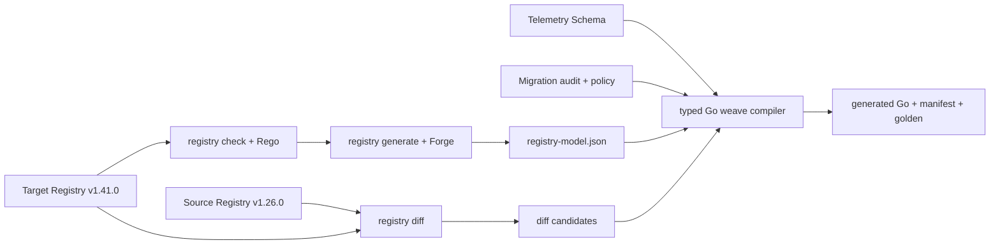
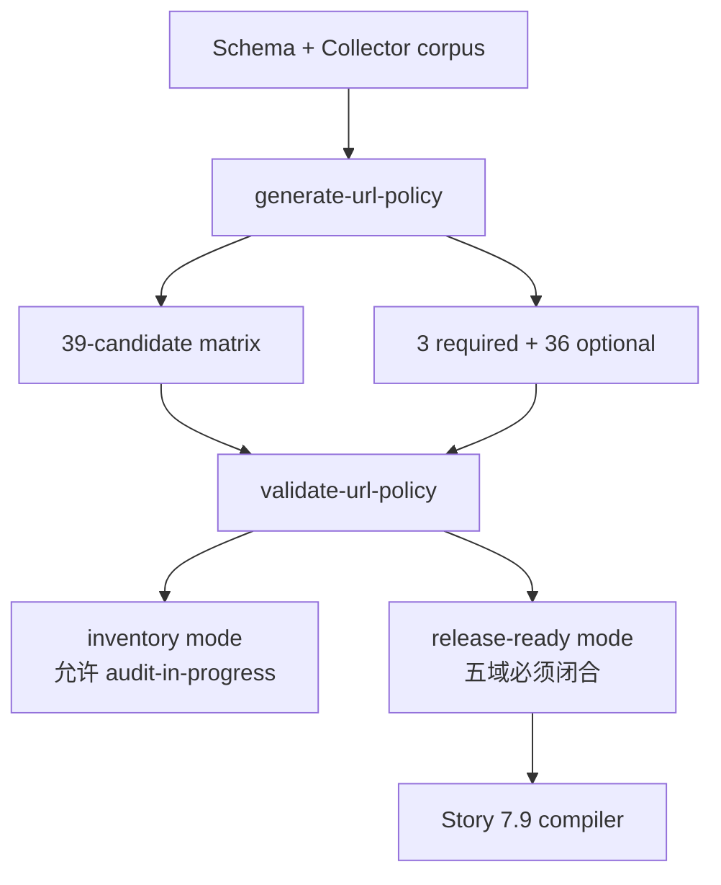
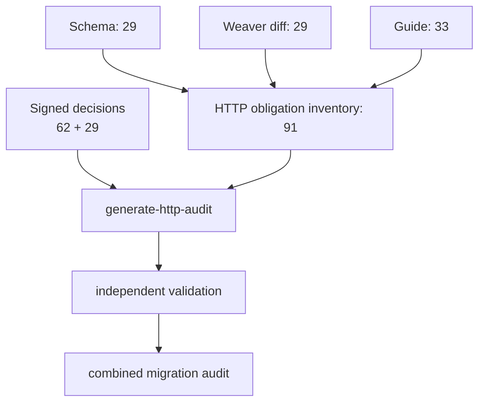
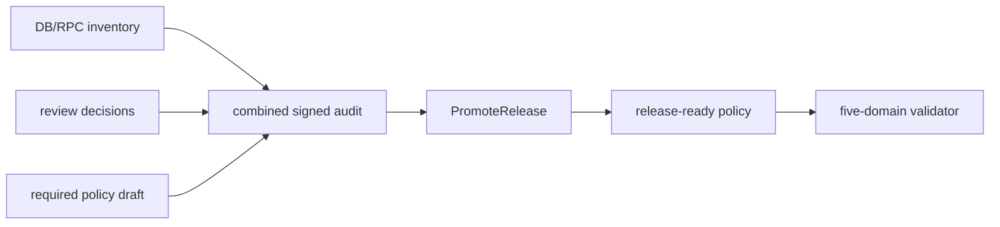
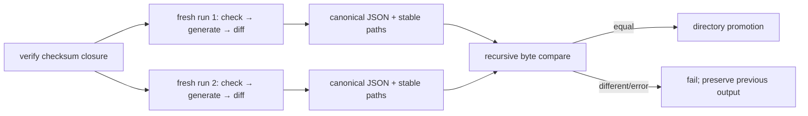
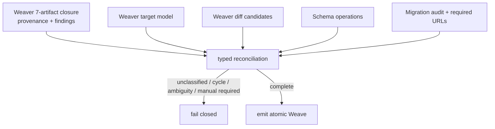

# Weaver 构建控制面契约

**状态：** Implemented，公开快照，版本以本仓库发布的 tag 为准
**日期：** 2026-07-28
**适用版本：** OpenTelemetry Weaver v0.25.0
**目标：** 让 Weaver 成为 SemConv Weave 的实际 schema-first 构建入口

## 1. 结论

本项目直接使用 Weaver 的四类能力：

1. Registry resolver：在 check/generate 内解析 `ref`/`extends`；
2. Checker + Rego：生成前执行 Registry contract；
3. Forge（jaq + MiniJinja）：生成稳定 canonical descriptor 与 review 文档；
4. Registry diff：枚举 source/target candidate changes。

Weaver 输出 v1.41.0 target model 和 `v1.26.0→v1.41.0` 候选差异；typed Go compiler 再与
Telemetry Schema operations、Migration Guide audit 和 Project policy 对账，生成最终 immutable
Weave。v1.26.0 是 Weaver v0.25.0 能解析的最早独立 Registry；旧 `1.4.0/1.7.0` 的完整 operation
链由 pinned Telemetry Schema 提供，不伪造旧 Registry。



Weaver 不进入 runtime，也不单独决定完整 migration semantics。

## 2. 固定版本与供应链

| Input | Exact value |
| --- | --- |
| Weaver release | `v0.25.0` |
| Weaver commit | `a177fb605e66ef8d3b333302459c805091bfedd7` |
| Linux x86_64 GNU SHA-256 | `8cbf46fc0137311eab7fd3860cb841031bb772f8613acc5923fa9ef3879c0cd5` |
| Apple Silicon SHA-256 | `32f1c4e9092f0ba4fe48b259ce3dc1d65c756db7f759fadf5338ebacdf53a3df` |
| Source Registry tag/commit | `v1.26.0` / `9adff435c76ea3b8cba89babefc832d3dd3c1ab9` |
| Source Registry archive SHA-256 | `ecf8658f85d2e06281470ec1d11d27534a6090f6e689343e757ba4ab7e1d1ece` |
| Target Registry tag/commit | `v1.41.0` / `e018fe6f91862f5ed63c082f87697cddac596784` |
| Target Registry archive SHA-256 | `6e2a13d9ccac76327bbb79578eced858b14fddbc96facbf56aab16a5b19cee93` |
| Canonical Schema URL | `https://opentelemetry.io/schemas/1.41.0` |
| Telemetry Schema SHA-256 | `d73002442a640ce74a185359843b9046884d16eec198c3576d2dcc779deaf740` |
| Registry data model | v1，显式 `--v2=false` |

CI 只读取已下载并校验 checksum 的 local fixtures，不从 `main`、`latest` 或网络 URL 生成。
Registry archive、Schema、Migration Guide、policy/template 和 audit checksum 统一写入
`checksums.txt`。

Story 7.2 已把这层供应链约束实现为独立 module：

```bash
GOWORK=off go -C tools/semconv-weave-gen run ./cmd/verify-inputs -root testdata
```

`input-lock.json` 固定上述 tool/source identity，`checksums.txt` 封闭 `testdata` 下除自身外的全部
regular files。verifier 只读本地文件，拒绝 symlink、path traversal、重复/乱序/漏项/额外文件、
unknown lock fields 和任意 checksum/identity mismatch，不访问网络。

两项 Weaver SHA 是官方发布 **archive asset** 的 SHA，不是解压后 executable 的 SHA。Registry
fixture 是从固定 commit 以 `git archive` 生成的 model archive，并记录实际 archive SHA。Schema
fixture 提交官方 URL 返回的精确 bytes。Story 7.4 已把 compatibility matrix、Collector URL
corpus 和 required URL policy 纳入同一个 checksum closure；template 与 migration audit 仍处于
后续编译/审计阶段，不能仅凭输入身份视为完整 migration 支持证据。

### Compatibility inventory 与 release readiness 分离

`generate-url-policy` 从 pinned Schema 提取全部 39 个 exact revision，再以 pinned Collector
corpus 收窄 required 集合。当前 required 为 `1.41.0`、`1.7.0`、`1.4.0`；其余 36 项固定为
optional/unknown。



独立 validator 绑定 matrix digest，校验 exact set、owner/evidence、canonical invariant、source
Registry 状态及 Resource/Span/Span Event/Span name/Event name 五域 disposition。draft 中历史
required URL 为 `manual_audit_required`；Story 7.5/7.6 完成审核和双签核后，release policy 已切换
为前三域 `translated`、name 两域 `pass_through`，release-ready gate 通过。

### HTTP/URL/Network 三方 obligation reconciliation

Story 7.5 将 HTTP/URL/Network 的权威输入显式分离：

| authority | artifact | 当前结果 |
| --- | --- | --- |
| Telemetry Schema | pinned v1.41.0 Schema trace operations | 29 obligations |
| Weaver Registry diff | pinned `diff/v1.26.0-to-v1.41.0/diff.json` | 29 relevant candidates |
| HTTP Migration Guide | trace tables、旧版本附注、span-name sections | 33 obligations |
| Project review | `http-url-network-decisions.json` | 62 Schema/Guide decisions + 29 Weaver actions |

生成器只枚举并 join，不从 Guide 自然语言自动批准变换。独立 validator 将 combined audit 与 source
inventory digest 双向对账，并拒绝缺项/额外项、unknown field、source locator 漂移、contextual
translated、空 golden。Schema/Guide catalog 中 11 项 pure rename 可执行、51 项保留 source；
Weaver catalog 中 9 项 translated、20 项 pass-through。



### DB/RPC reconciliation、双签核与 policy promotion

Story 7.6 延续相同模型：原 Schema/Guide/root inventory 137 项，加入 52 项 relevant Weaver
candidate 后共 189 项；Weaver action catalog 为 25 translated / 27 pass-through。Story 7.8 已把
19 个本地 alias 的所有权迁到 `internal/semconvmeta`，并由 `cmd/export-semconvmeta` 生成带 source
SHA 的 build-module handoff。Guide value table 与该本地 descriptor 做双向对账；18 个官方 value
rename 可编译，Removed 的 `cache` 只保留 getter compatibility，不授权 attribute translation。
`semconvmeta` 不能覆盖 Weaver target model。

combined audit 只有在以下两项 sign-off 都存在且 digest 完全匹配时有效：

- `classifier_maintainer`；
- `semantic_reviewer`。

每个签核绑定 DB/RPC inventory、DB Guide、RPC Guide 和 pre-promotion policy SHA。生成顺序固定为：



任一 source、decision、sign-off 或 draft policy 变化都会使 digest 失效，不能产生 release policy。

## 3. Weaver 职责

| Weaver capability | Output / gate | Consumer |
| --- | --- | --- |
| `registry check` | built-in findings + Rego findings | CI/reviewer |
| `registry generate` | `registry-model.json`、`registry-review.md` | compiler/human review |
| jaq | 选择 trace normalization 所需 groups/attributes | MiniJinja |
| MiniJinja | 稳定 JSON/Markdown 数据投影 | compiler/human review |
| `registry diff` | candidate diff JSON | reconciliation |
| diagnostic JSON | machine-readable findings | CI artifacts |

Rego 只执行 Registry 合法性 guard，不实现 rename、fallback、winner 或 multi-hop folding。
MiniJinja 只投影数据，不生成 runtime algorithm。canonical target 是否存在、prefix type、enum
value 与 deprecated 状态由 typed compiler 读取 `registry-model.json` 后严格校验。

建议固定 finding IDs：

```text
otelmap.canonical_target_missing
otelmap.canonical_target_deprecated
otelmap.canonical_type_mismatch
otelmap.trace_group_unresolved
```

## 4. 目录与产物

```text
tools/semconv-weave-gen/
  go.mod
  cmd/verify-inputs/
  cmd/weaver-baseline/
  internal/inputlock/
  internal/weaverbaseline/
  testdata/
    upstream/weaver/
    upstream/registry/semantic-conventions-v1.26.0-model.tar
    upstream/registry/semantic-conventions-v1.41.0-model.tar
    schema/opentelemetry-1.41.0.yaml
    guides/
    local/
      policies/otelmap-canonical.rego
      templates/registry/otelmap-weave/
    audit/migration-audit-v1.41.0.yaml
    audit/required-source-urls.yaml
    input-lock.json
    checksums.txt
  build/weaver/
    findings-*.json
    registry-model.json
    registry-review.md
    diff/<source>-to-v1.41.0/diff.json
    provenance.json
```

`cmd/verify-inputs`、`internal/inputlock` 和 pinned `testdata` 由 Story 7.2 实现。
`cmd/weaver-baseline`、`internal/weaverbaseline`、可执行 policy/template 与 `build/weaver`
证据由 Story 7.3 实现。policy/template 仍放在 checksum-locked `testdata/local`，避免出现一份被
校验、另一份被执行的双重真相。

Story 7.3 baseline 实际产出 935 个 target resolved groups。Weaver Forge template 使用 `tojson`
生成 target model；wrapper 随后严格解析并 canonical serialize JSON、把 Registry staging path
重写成稳定的 archive-relative path。原因是 Weaver v0.25.0 的 `registry diff --format=json`
对 object key 的 emission 顺序不稳定，原始 `diff.json` 不能直接作为 byte-stable artifact。
wrapper 只规范 object key/host path，不改变 source-order array；typed schema/audit 对账留给
Story 7.8。

## 5. Hermetic CLI 协议

wrapper 使用绝对路径、隔离配置目录和已校验 fixture：

```bash
"$WEAVER_BIN" registry check \
  --quiet \
  --registry "$TARGET_REGISTRY" \
  --policy "$POLICY_DIR" \
  --follow-symlinks=false \
  --include-unreferenced=false \
  --v2=false \
  --diagnostic-format=json \
  --diagnostic-stdout=true

"$WEAVER_BIN" registry generate otelmap-weave "$OUTPUT_DIR" \
  --quiet \
  --registry "$TARGET_REGISTRY" \
  --templates "$TEMPLATE_DIR" \
  --policy "$POLICY_DIR" \
  --follow-symlinks=false \
  --include-unreferenced=false \
  --v2=false \
  --diagnostic-format=json \
  --diagnostic-stdout=true

"$WEAVER_BIN" registry diff \
  --quiet \
  --registry "$TARGET_REGISTRY" \
  --baseline-registry "$SOURCE_REGISTRY" \
  --follow-symlinks=false \
  --include-unreferenced=false \
  --v2=false \
  --format=json \
  --output "$DIFF_OUTPUT_DIR" \
  --diagnostic-format=json \
  --diagnostic-stdout=true
```

维护者不应手工拼上述三条命令。仓库内唯一入口会先验证 input closure，再连续运行两次完整
pipeline：

```bash
cd tools/semconv-weave-gen
GOWORK=off go run ./cmd/weaver-baseline \
  -inputs "$(pwd)/testdata" \
  -output "$(pwd)/build/weaver"
```

成功时命令静默退出 0，并目录级提升 `build/weaver`；失败时退出非零且保留旧 output。当前支持
`darwin/arm64` 与 `linux/amd64`，需要平台 `tar` 解压已经 checksum-verified 的 Weaver
`.tar.xz` release asset。解压后 wrapper 还会验证唯一 `weaver` executable、`weaver 0.25.0`
版本并记录 executable SHA。wrapper 把 checksum-verified policy/template 复制到 fresh staging，
避免 Forge 沿宿主目录发现 ambient config；check/diff 显式使用 staging 内空 `.weaver.toml`，
generate 只从 staging template target 加载 `weaver.yaml`。

硬约束：

- 禁止 `registry resolve`，因为 v0.25.0 已标记 deprecated；
- `--output` 对 diff 是目录，实际文件是 `<dir>/diff.json`；
- `--quiet` 防止 progress text 污染 JSON；
- 无 finding 的零字节/纯空白输出规范化为 `[]\n`；
- 非空 diagnostics 必须恰好是一个 JSON array；object、第二个 JSON 值、progress text、stderr
  或非零 exit 都 fail closed；
- 每次 diff 的 provenance 显式记录 source/target version、commit、archive SHA、Weaver SHA 和参数；
- provenance 的 argv 使用 `${STAGING}`（必要时 `${INPUTS}`）稳定根变量表达实际 absolute
  argv，不记录开发机 temp path、时间、hostname 或用户名；
- 不依赖 diff JSON 的 head/baseline semconv_version，因为官方 model 可能为空。

Story 7.3 现在执行真实 `v1.26.0→v1.41.0` diff；Registry attributes 有 567 项 changes，其中
81 项 HTTP/Network/DB/RPC relevant candidate 全部进入 signed reconciliation。该真实非空 diff
与 model、review、三个 findings、provenance 组成严格七件 artifact closure。



## 6. Compiler Reconciliation Gate



compiler 负责：

- revision operation 顺序与 multi-hop folding；
- Weaver artifact/provenance identity 与 digest closure；
- executable target key/type/enum/deprecation model validation；
- Schema/diff/guide 三方并集对账；
- translated/pass-through/unsupported 分类；
- conflict winner 和 missing/unknown semantics；
- `WeaveID` lookup、generated ABI assertion、manifest digest；
- Go source、support manifest、golden。

`manual_audit_required` 可以出现在 build report，但不能进入 required runtime weave。

Story 7.8 已实现 `internal/typedir` 与显式入口：

```bash
cd tools/semconv-weave-gen
GOWORK=off go run ./cmd/compile-typed-ir \
  -root testdata \
  -weaver-root build/weaver \
  -output build/typed-ir.json
```

该命令先执行 input/Weaver evidence/model/diff/policy/audit gates，再用
`go.opentelemetry.io/otel/schema v0.0.17` 的 v1.1 strict parser 编译 exact `1.7.0`、`1.4.0`，
canonical `1.41.0` 输出 no-op；optional URL 不会进入 IR。Typed IR 是 Story 7.9 emitter 的私有
输入，不是 runtime ABI。

Story 7.9 的 emitter 不接受旁路 IR 文件，而是直接调用上述 verified compiler：

```bash
cd tools/semconv-weave-gen
GOWORK=off go run ./cmd/generate-runtime-artifacts \
  -root testdata \
  -weaver-root build/weaver \
  -provider-root ../.. \
  -output build/_fresh-runtime-artifacts

GOWORK=off go run ./cmd/generate-runtime-artifacts \
  -root testdata \
  -weaver-root build/weaver \
  -provider-root ../.. \
  -check
```

`-output` 只接受不存在的 fresh staging 目录；`-check` 对四个 checked artifact 做逐字节比较。
generator 内部也连续 emission 两次并比较 path/bytes。失败发生在 staging/promotion 之前，不修改
checked runtime truth。

当前 source manifest schema v2 把七件 Weaver artifact 与统一
`weaver_evidence_sha256=c74f2968b9c0613d514dd55f885186d2048c62cdcbb61f2da1087654e878c3bc`
纳入 Typed IR input identity；最终
`SourceManifestSHA256=fe56440cbfa52fc2cad1d70d1494cbf0dcdee0f4352dbb9bd724f02263a16e60`。
每个 1.4/1.7 exact weave 与 unversioned fallback union 均为 88 key、54 value、0 name rule。

## 7. 可复现与升级门禁

CI 顺序：

1. 校验所有 input/artifact checksums；
2. 两次从独立 fresh staging 运行 check/generate/diff，canonicalize JSON 后对完整 artifact tree
   做 byte diff；
3. typed compiler 与 runtime emitter 各自两次生成并做 path/byte diff；
4. 验证 runtime module graph 无 build-only dependency；
5. 保存 findings、model、diff、provenance 和 review；
6. Weaver 升级时重跑 source compatibility matrix 与完整 reconciliation。

普通 `go build`/`go test` 不隐式运行 generation、不联网；真实 pinned pipeline 由 nested module
integration test 和上述显式 command 触发。可发布证据以 Linux CI artifact 为准。

## 参考

- [OpenTelemetry Weaver](https://github.com/open-telemetry/weaver)
- [Weaver v0.25.0](https://github.com/open-telemetry/weaver/releases/tag/v0.25.0)
- [Observability by Design with Weaver](https://opentelemetry.io/blog/2025/otel-weaver/)
- [Schema normalization design](weaver-build-contract.md)
