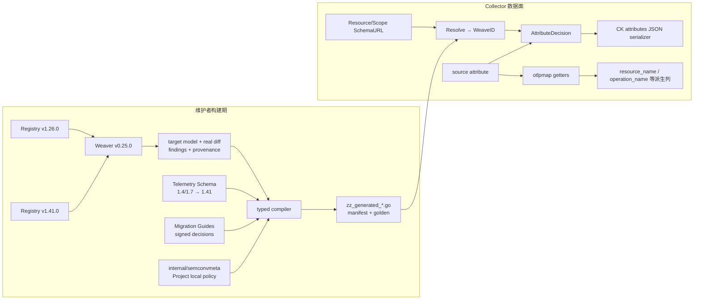

# semconvweave Quickstart

`semconvweave` 的使用模型只有一句话：

> 在 Resource/Scope 边界解析一次 `WeaveID`，随后在调用方已有的属性遍历中，把每个 source
> attribute 交给它，并按 `AttributeDecision` 写出 canonical key/value。

它不会修改输入 `pcommon.Map`，也不会在运行时读取 Weaver、Registry、Schema、YAML 或审计文件。
普通 Collector consumer 只依赖本包和已经生成的静态 Go 表。

## 一分钟跑通一个属性

外部项目使用已发布版本：

```bash
go get github.com/XiaoWeiKIN/otel-semconv-normalizer@latest
```

把 `vX.Y.Z` 替换为实际发布 tag。

下面把 SemConv 1.7 的 `db.system=mssql` 投影为 v1.41.0 的
`db.system.name=microsoft.sql_server`：

```go
package main

import (
	"fmt"

	"github.com/XiaoWeiKIN/otel-semconv-normalizer/semconvweave"
	"go.opentelemetry.io/collector/pdata/pcommon"
)

func emitDecision(
	dst pcommon.Map,
	sourceValue pcommon.Value,
	decision semconvweave.AttributeDecision,
) {
	switch decision.Action {
	case semconvweave.AttributeSuppress:
		return
	case semconvweave.AttributeReplaceString:
		dst.PutStr(decision.Key, decision.StringValue)
	case semconvweave.AttributeKeepValue:
		sourceValue.CopyTo(dst.PutEmpty(decision.Key))
	default:
		panic("unknown semconvweave action")
	}
}

func main() {
	source := pcommon.NewMap()
	source.PutStr("db.system", "mssql")

	weave := semconvweave.Resolve(
		"https://opentelemetry.io/schemas/1.7.0",
	)

	projected := pcommon.NewMap()
	value, _ := source.Get("db.system")
	decision := weave.SpanAttribute(
		source,
		"SELECT users",
		"db.system",
		value,
	)
	emitDecision(projected, value, decision)

	target, _ := projected.Get("db.system.name")
	fmt.Println(weave.State())
	fmt.Println(target.Str())
	// Output:
	// supported-legacy
	// microsoft.sql_server
}
```

这个示例创建了新的 `pcommon.Map`，便于展示结果。生产热路径应把 decision 直接写进现有
fastjson/ClickHouse serializer，避免构造中间 Map。

## v1.41.0 语义迁移补充

Span 属性完整迁移使用 `WeaveID.ProjectSpan(span, options)`。它返回新的 Attributes、
StatusDescription 和 Issues，不修改输入。`Complete()` 为 false 表示有缺失上下文或非法值，
调用方不能将这批结果宣称为完整 canonical 数据；`removed` 是社区删除项的处理记录，
不导致失败。Resource/Scope 的 Schema URL 不能因为单个 Span 完成就整体改写。

| 输入 | v1.41.0 处理 |
| --- | --- |
| `http.method` | 默认 10 个标准方法；未知值输出 `_OTHER` 和 `http.request.method_original`；支持完整替换已知方法集合 |
| HTTP body size、网络协议、连接、运营商旧属性 | 生成的一跳改名；HTTP 协议版本 `2.0/3.0` 变成 `2/3`，非 HTTP 版本保留 |
| `http.flavor` | HTTP 版本迁移；SPDY/QUIC 输出小写协议名，不编造版本号 |
| socket peer/local 属性 | `network.peer.*` / `network.local.*`；HTTP SERVER 缺少转发客户端地址时，peer 地址补为 `client.address` |
| `http.target` / `http.url` | 拆分 path/query；完整 URL 删除 userinfo；按固定社区清单脱敏 query 值，保留参数顺序和原始编码 |
| `http.scheme`、`net.host.name/port` | 通过 `HTTPServer` 提供采集端按可信代理策略解析后的请求 scheme/authority |
| `http.host` | 使用 `HTTPHostTarget` 明确历史含义，输出 server/client 地址及端口，或 Host header 数组 |
| 旧 HTTP header 后缀 | `HeaderNames` 提供原始名字后转换；不能直接把所有下划线替换成连字符 |
| `db.name` 等 namespace 来源 | SQL Server instance/database 组合；Redis index 字符串化；Cassandra/HBase 按数据库类型处理 |
| `db.operation`、MongoDB/Cassandra/CosmosDB 集合名 | 对齐 operation/collection 属性，不改变大小写 |
| `db.statement` | `SanitizeDBQuery` 回调提供数据库方言对应的清洗结果后输出 `db.query.text` |
| `db.sql.table` | `DBCollection` 提供应用给出的单一集合名；不从 SQL 猜测集合 |
| `db.instance.id` | `DBInstanceNamespace` 或 `DBInstanceServer` 明确数据库实例含义后迁移 |
| `db.cosmosdb.status_code` | 整数转 `db.response.status_code` 字符串 |
| `rpc.grpc.status_code` / `rpc.jsonrpc.error_code` | gRPC 0–16 转官方状态名称；JSON-RPC 整数转十进制字符串 |
| `rpc.service` + `rpc.method` | 合并完整方法名；以 `KnownRPCMethods` 判断已知方法，未知值输出 `_OTHER` 与 original |
| `rpc.jsonrpc.error_message` | ERROR Span 的 status description；已有 description 优先 |
| RPC peer 地址及旧 RPC 的同名 server 地址 | 使用 `RPCServer` 的静态逻辑服务地址；dual emit 的当前 `rpc.system.name`/server 属性优先，不用 socket peer 推断 |
| 社区删除且无等价替代的属性 | 删除并返回 `removed` 记录；RPC 消息事件本身不属于本接口 |

`KnownHTTPMethods` 和 `SensitiveQueryParameters` 的 nil 使用社区默认集合，非 nil 是完整
覆盖。默认敏感 query key 为 `AWSAccessKeyId`、`Signature`、`sig`、`X-Goog-Signature`，
匹配区分大小写，替换值为 `REDACTED`。项目特有敏感字段由采集端策略额外提供。
`KnownRPCMethods` 必须来自框架注册信息；nil 不代表所有方法都可信。已经输出新属性的
producer 保留其当前方法策略，带有旧 RPC 字段的记录才执行同名 `rpc.method` 迁移。

current target 按存在性优先，即使其类型不正确也不会被 legacy 覆盖。同一目标存在多种
legacy 来源时按明确优先级选取，输出不依赖输入遍历顺序。非法或缺少上下文的输入保留
原属性并报告原因；这不是自动推断缺失元数据。没有新增 Kubernetes Span/Resource 搬迁，
也没有 Facet 特定补偿。

`SpanAttribute` 的签名和 ABI v1 布局不变；`SpanAttributeWithContext` 仍提供两个固定
输出槽位，适合 HTTP method/original 与基础 DB/network 转换。它们不能表达全部复合迁移、
状态描述和诊断，完整接入必须使用 `ProjectSpan`。新入口分配独立属性 Map；原单属性快路径
保持可用，不承担这项分配。

完整投影的性能路径复用已有的前缀/长度 bitmap，在一次扫描中收集具体迁移任务的
工作位，以及 HTTP 身份和 RPC system 上下文。URL、Header、socket、DB query、RPC
status 等处理器只在相关源字段出现时执行；非法类型仍会设置工作位，保留原有诊断。
上下文工作位不替代生成规则筛选，新增上下文迁移必须同时更新任务分流和差分测试。

没有单属性转换候选时使用 pdata 批量复制。至少 32 个属性、仅 1—2 个转换候选时，
先基于完整且不可变的源 Map 计算转换计划和所需容量，再批量复制并移动输出 Map 内的
值，避免对每个未变属性执行线性写入查重。每次插入后重新获取 pdata Value，避免使用
失效引用。其他情况逐项构造投影结果；上下文专属的 `net.peer.name/port` 仍显式加入
候选筛选。所有路径都返回独立持有嵌套值的 Map，源 Span 不变。

性能对照与差分测试保留在 `semconvweave/*_test.go`。可在本地运行微基准；结果取决于输入与运行环境。

静态 IR 审计中的 pass-through 表示“不能作为单属性纯改名执行”，不等同于新入口不支持。
生成规则与手写上下文规则分别验证；`TestMigrationGuideAttributeCoverage` 对锁定的
HTTP/Network/DB/RPC 清单逐项检查静态规则、上下文处理及不需要改值的要求，新增未分类
属性会使测试失败。具体实现和输入快照均纳入 source manifest。

规范依据为固定的 [HTTP 迁移指南](../tools/semconv-weave-gen/testdata/guides/http-migration.md)、
[DB 迁移指南](../tools/semconv-weave-gen/testdata/guides/db-migration.md)、
[RPC 迁移指南](../tools/semconv-weave-gen/testdata/guides/rpc-migration.md) 和
[v1.41.0 Registry model](../tools/semconv-weave-gen/build/weaver/registry-model.json)。
此接口处理已记录的 Span 属性，不声称补齐采集端 instrumentation 的时机、缺失属性、
Span name、Event、Metric 或 Resource 归属。

## 三种 action 决定如何写出

每个 source attribute 只产生一种结果：

| Action | 调用方行为 | 典型场景 |
| --- | --- | --- |
| `AttributeSuppress` | 不写当前 source | canonical target 已存在，或另一个 legacy source 优先级更高 |
| `AttributeKeepValue` | 使用 `decision.Key`，值沿用原 `pcommon.Value` | key rename、未知 string value、wrong type、原样透传 |
| `AttributeReplaceString` | 使用 `decision.Key` 和 `decision.StringValue` | 已审核的确定性 string value 归一化 |

`AttributeKeepValue` 不等于“保留旧 key”。实际输出 key 始终读取 `decision.Key`：

```text
source:   db.system = future-db
decision: Key=db.system.name, Action=KeepValue
output:   db.system.name = future-db
```

无法安全迁移的属性会真正保留 source：

```text
source:   db.statement = select 1
decision: Key=db.statement, Action=KeepValue
output:   db.statement = select 1
```

## Collector 按 Resource/Scope 选择 Weave

OTLP trace 的 Schema URL 有两个层级：

- Resource attributes 使用 `ResourceSpans.SchemaUrl()`；
- Span、Span Event 和 Span name 使用 `ScopeSpans.SchemaUrl()`；
- Scope URL 为空时回退 Resource URL。

在 Collector 的既有循环中只解析一次：

```go
resourceSchemaURL := resourceSpans.SchemaUrl()
resourceWeave := semconvweave.Resolve(resourceSchemaURL)

scopeSchemaURL := scopeSpans.SchemaUrl()
if scopeSchemaURL == "" {
	scopeSchemaURL = resourceSchemaURL
}
spanWeave := semconvweave.Resolve(scopeSchemaURL)
```

不要为每个 span 或每个 attribute 重复调用 `Resolve`。

### 把 decision 接进已有 serializer

先给现有 writer 增加两个很小的写入能力：

```go
type AttributeWriter interface {
	WriteValue(key string, value pcommon.Value)
	WriteString(key, value string)
}

func writeDecision(
	writer AttributeWriter,
	sourceValue pcommon.Value,
	decision semconvweave.AttributeDecision,
) {
	switch decision.Action {
	case semconvweave.AttributeSuppress:
		return
	case semconvweave.AttributeKeepValue:
		writer.WriteValue(decision.Key, sourceValue)
	case semconvweave.AttributeReplaceString:
		writer.WriteString(decision.Key, decision.StringValue)
	default:
		panic("unknown semconvweave action")
	}
}
```

`WriteValue` 应复用 exporter 已有的 OTLP value serializer，继续正确处理 int、double、bool、bytes、
slice 和 map。只有 `AttributeReplaceString` 写入新的 string。

Resource attributes：

```go
resourceAttrs := resourceSpans.Resource().Attributes()
resourceAttrs.Range(func(key string, value pcommon.Value) bool {
	if !semconvweave.MayTranslateResourceAttribute(key) {
		resourceWriter.WriteValue(key, value)
		return true
	}
	decision := resourceWeave.ResourceAttribute(
		resourceAttrs,
		key,
		value,
	)
	writeDecision(resourceWriter, value, decision)
	return true
})
```

Span attributes、既有派生列与 Span name：

```go
// import otlpmap "github.com/XiaoWeiKIN/otel-semconv-normalizer"

sourceSpanName := span.Name()
spanAttrs := span.Attributes()

// options 按上表提供采集端已知信息；不要猜测缺失上下文。
projection := spanWeave.ProjectSpan(span, options)
projection.Attributes.Range(func(key string, value pcommon.Value) bool {
 spanAttributeWriter.WriteValue(key, value)
 return true
})
// serializer 同时使用 projection.StatusDescription 写出状态描述。
// 记录 projection.Issues；Complete()==false 时不能宣称完整 canonical。

// Project 派生列继续读取未修改的 source attributes。
operationName := otlpmap.GetOperationName(spanAttrs, span.Kind())
resourceName := otlpmap.GetResourceName(spanAttrs, span.Kind(), sourceSpanName)

canonicalSpanName := spanWeave.SpanName(sourceSpanName)
```

`semconvweave` 不负责提取 `operation_name`、`resource_name`、technology 或 entity type。这些
Project 派生列继续调用 `otlpmap` 的既有 getter，并读取原始 `pcommon.Map`。attribute decision
只在写 CK attributes JSON 时消费，不会反向改变派生列输入。

Span Event attributes 与 Event name：

```go
sourceEventName := event.Name()
eventAttrs := event.Attributes()

eventAttrs.Range(func(key string, value pcommon.Value) bool {
	if !semconvweave.MayTranslateEventAttribute(key) {
		eventAttributeWriter.WriteValue(key, value)
		return true
	}
	decision := spanWeave.EventAttribute(
		eventAttrs,
		sourceSpanName,
		sourceEventName,
		key,
		value,
	)
	writeDecision(eventAttributeWriter, value, decision)
	return true
})

canonicalEventName := spanWeave.EventName(
	sourceSpanName,
	sourceEventName,
)
```

`MayTranslate*Attribute` 是可选的保守 fast-path：返回 false 时一定没有已安装
translation，调用方可以直接写 source；返回 true 仍可能是 false positive，必须继续调用
`WeaveID.*Attribute`。`WeaveID.*Attribute` 内部也保留同一 guard，所以不使用外层 fast-path
不会影响正确性。

所有 name 参数都传入归一化前的 source name。attribute projection、Project 派生列和最终
Span/Event name 分别消费同一份只读 source 数据；只有 CK attributes JSON writer 消费
`AttributeDecision`。

Span Link 当前固定 pass-through；metrics、logs 和 Scope attributes 不在本包的投影范围内。

## `Resolve` 状态和实际规则集是两个概念

`State()` 用于低基数观测；它不会完整描述实际执行的 fallback：

| Schema URL | `State()` | 使用的规则 |
| --- | --- | --- |
| `1.4.0`、`1.7.0` | `supported-legacy` | 对应 source 的 exact weave |
| `1.41.0` | `canonical` | 安全的 unversioned fallback union |
| 空字符串 | `missing` | 安全的 unversioned fallback union |
| 其他非空 URL | `unknown` | 安全的 unversioned fallback union |

fallback union 只包含无需猜测版本即可执行、且在所有已支持 source 中没有歧义的规则。因此
missing、unknown 或 canonical payload 中出现 `db.system` 时，仍会归一化为
`db.system.name`。这不会把未知 URL 猜成 1.4 或 1.7。

当前 exact 1.4/1.7 weave 各包含：

- 88 条 key rule；
- 54 条 value rule；
- 0 条 name rule；
- 379 条 disposition evidence。

unversioned fallback union 为 88 key / 54 value / 0 name。

## 构建期生成规则，运行时只执行不可变表



Weaver v0.25.0 能解析的最早独立 Registry 是 v1.26.0，所以真实 Registry diff 为
`v1.26.0→v1.41.0`。Telemetry Schema 继续提供 `1.4.0/1.7.0→1.41.0` 的完整 operation chain。

### Weaver model 与 `internal/semconvmeta` 各管一层

| 输入 | 权威范围 |
| --- | --- |
| Weaver target model | v1.41.0 key 是否存在、类型、enum value、deprecated 状态 |
| Telemetry Schema | 历史 revision 的 operation 顺序 |
| Migration Guide + signed decisions | rename 是否能安全执行，或必须保留 source |
| `internal/semconvmeta` | Project getter 顺序、legacy/vendor alias、value fallback、projection policy |

`internal/semconvmeta` 提出的 target 必须通过 Weaver model 和 signed audit。它不能创建官方
Registry 中不存在的 canonical key，也不能让 deprecated target 进入 runtime。

反过来，Weaver diff 中已审核的安全 rename 可以直接生成规则，无需先复制到
`internal/semconvmeta`。例如 `net.host.ip→network.local.address` 来自 Weaver diff。

## 普通 consumer 不运行 Weaver

使用已发布 classifier 的 Collector 只执行：

```text
Resolve
MayTranslateResourceAttribute / MayTranslateSpanAttribute / MayTranslateEventAttribute
ResourceAttribute / SpanAttribute / EventAttribute
SpanName / EventName
otlpmap.GetOperationName / otlpmap.GetResourceName
```

以下命令只供规则维护者使用：

```bash
cd tools/semconv-weave-gen

GOWORK=off go run ./cmd/verify-inputs \
  -root testdata

GOWORK=off go run ./cmd/weaver-baseline \
  -inputs testdata \
  -output build/weaver

GOWORK=off go run ./cmd/validate-url-policy \
  -release-ready

GOWORK=off go run ./cmd/validate-combined-audit

GOWORK=off go run ./cmd/compile-typed-ir \
  -root testdata \
  -weaver-root build/weaver \
  -output build/typed-ir.json

GOWORK=off go run ./cmd/generate-runtime-artifacts \
  -root testdata \
  -weaver-root build/weaver \
  -provider-root ../.. \
  -check
```

任一 checksum、Weaver artifact、model target、diff decision 或 audit identity 不匹配，compiler
都会 fail closed。主模块的普通 `go build` 和 `go test` 不运行这些命令。

## 接入检查清单

- Resource 与 Scope 的 Schema URL 不要混用；
- Scope URL 为空时回退 Resource URL；
- 每个 Resource/Scope 分组只调用一次 `Resolve`；
- 把完整 source Map 传给 attribute API，winner 判断需要检查 target 和其他 legacy source；
- 遍历期间不要修改 source Map；
- `AttributeKeepValue` 使用 `decision.Key`，不要固定写回 source key；
- `AttributeSuppress` 必须真正跳过输出，不能 dual-write；
- 所有 Span/Event name 参数使用变换前的 source name；
- `resource_name`、`operation_name` 等派生列继续调用 `otlpmap` getter 读取 source Map；
- `AttributeDecision` 只写 CK attributes JSON，不作为派生列的输入；
- unsupported/context-dependent 属性保留 source，不自行补造 target；
- 生产路径直接写现有 serializer，避免为了归一化构造完整中间 Map。

更完整的设计、证据和维护约束见：

- [Schema 归一化设计](../docs/weaver-build-contract.md)
- [Weaver 构建控制面契约](../docs/weaver-build-contract.md)
- [SemConv 兼容策略](../docs/semconv-compatibility-policy.md)
- 发布与 Collector 移交
